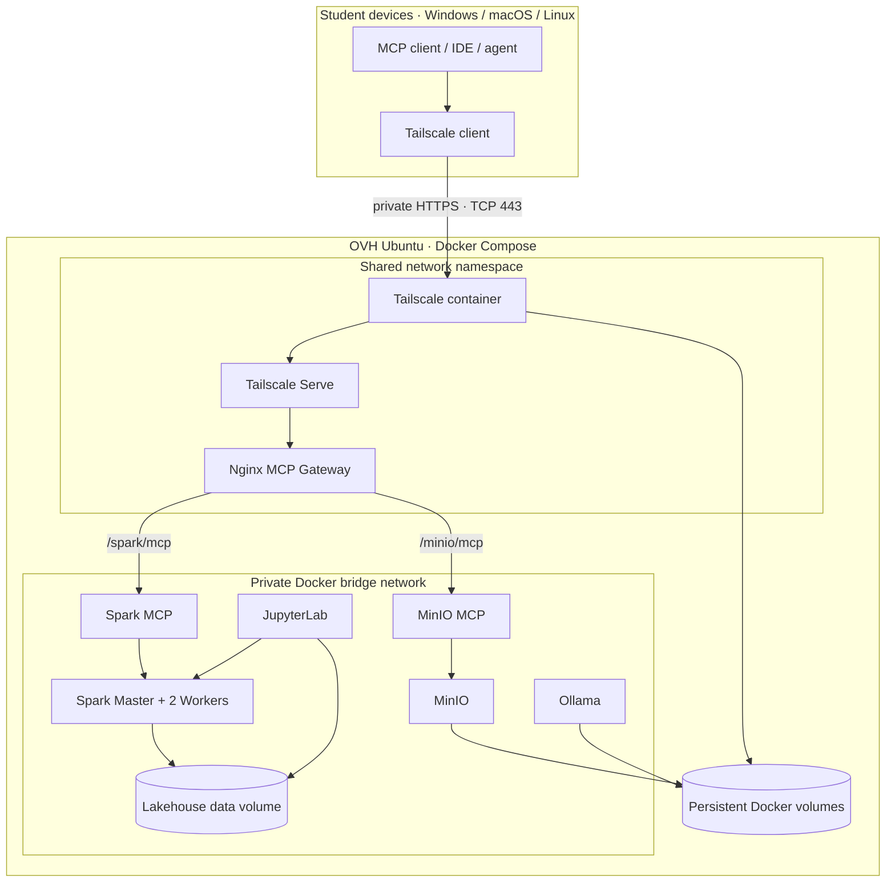

# Spark Lakehouse Agent Platform

A containerized Spark Lakehouse and MCP platform for Data Engineering and Agentic AI training. The **default deployment is one Docker Compose stack**, including Spark, JupyterLab, Ollama, MinIO, both MCP servers, an Nginx MCP gateway, and a Tailscale container with declarative Tailscale Serve.

**No host installation of Spark, Java, Python, Jupyter, MinIO, Nginx, or Tailscale is required.** The OVH server needs Docker Engine and Docker Compose v2. Students can connect from Windows, macOS, or Linux using their own Tailscale client; Google Colab uses the supplied notebook workflow.

## 1. Platform services

| Service | Version / role | Access |
|---|---|---|
| Spark Standalone | Spark 3.5.6, one master + two workers | Internal Docker network; UI loopback |
| JupyterLab | Custom image, PySpark enabled | Loopback |
| Ollama | 0.12.6, default model Qwen 2.5 3B | Loopback API |
| MinIO | Persistent S3-compatible object storage | Loopback API and console |
| Spark MCP | Streamable HTTP, bounded read-only Spark tools | Local loopback + private Serve |
| MinIO MCP | Streamable HTTP, bucket-scoped object tools | Local loopback + private Serve |
| MCP Gateway | Nginx path router, SSE/streaming aware | Internal; loopback diagnostics |
| Tailscale | Containerized userspace networking | Private tailnet |
| Tailscale Serve | HTTPS 443, configured from JSON | Tailnet only; Funnel disabled |

Phase 1 provides the infrastructure and MCP interfaces. Retail ingestion, Spark S3A/MinIO integration, CrewAI orchestration, and Streamlit dashboards remain later phases.

## 2. Architecture



**Remote endpoints** (replace the tailnet suffix with the actual name shown by `tailscale status`):

- Spark MCP: `https://spark-lakehouse-agent.<tailnet>.ts.net/spark/mcp`
- MinIO MCP: `https://spark-lakehouse-agent.<tailnet>.ts.net/minio/mcp`

Tailscale Serve routes both paths over HTTPS 443. The MCP services are not exposed on the OVH public interface.

## 3. Prerequisites

### Server (OVH Ubuntu)
- Docker Engine
- Docker Compose v2 plugin
- Outbound Internet access for image pulls and Tailscale control-plane connectivity
- Recommended: 16 GB RAM minimum, 32 GB preferred; 4+ CPU cores; 30+ GB free disk

The server does **not** need host-level Tailscale, Nginx, Java, Spark, Python, or MinIO installations.

### Students
- Windows, macOS, or Linux
- Official Tailscale client, signed in to an account authorized by the tailnet administrator
- An MCP-compatible client/IDE/agent

For Google Colab, use `notebooks/01_colab_private_mcp_validation.ipynb`; it creates a temporary userspace Tailscale node and SOCKS5 proxy.

## 4. One-time Tailscale administration

Before first deployment, the tailnet administrator must:
1. Enable MagicDNS.
2. Enable HTTPS Certificates.
3. Define and authorize `tag:spark-lakehouse-mcp`.
4. Generate a reusable, non-ephemeral auth key restricted to that tag for the long-running platform container.
5. Add a grant/ACL allowing the student group to reach only this platform node on TCP 443.

Students use their own identities. Never share the platform auth key with students. Tailscale Serve is tailnet-only and Funnel is disabled in the checked-in Serve configuration.

## 5. Configure and deploy

Clone the repository:

```bash
git clone https://github.com/msellamiTN/spark-lakehouse-agent.git
cd spark-lakehouse-agent
```

Create the local environment file:

**Linux / macOS**
```bash
cp .env.example .env
```

**Windows PowerShell**
```powershell
Copy-Item .env.example .env
```

Edit `.env` and set strong values for `JUPYTER_TOKEN`, `MINIO_ROOT_PASSWORD`, and the tagged `TS_AUTHKEY`. The file is excluded by `.gitignore`.

Validate and launch the complete platform:

```bash
docker compose config --quiet
docker compose up -d --build
docker compose ps
```

This starts the full platform, including Tailscale and Serve. There is no second Compose file and no manual host-level `tailscale serve` command.

Inspect the private node and Serve routes:

```bash
docker compose exec tailscale tailscale status
docker compose exec tailscale tailscale serve status
```

The Tailscale container uses userspace networking, so it does not require `/dev/net/tun`, `NET_ADMIN`, or a host `tailscaled` service. Its identity is persisted in the `tailscale_state` named volume.

### Convenience scripts

Linux / macOS:
```bash
./scripts/setup.sh
./scripts/up.sh
./scripts/validate.sh
```

Windows PowerShell:
```powershell
.\scripts\setup.ps1
.\scripts\up.ps1
.\scripts\validate.ps1
```

## 6. Student connection

1. Install Tailscale on the student device and sign in with an authorized individual account.
2. Confirm the device is connected to the same tailnet and MagicDNS is enabled.
3. Configure the MCP client with:

```text
Spark MCP: https://spark-lakehouse-agent.<tailnet>.ts.net/spark/mcp
MinIO MCP: https://spark-lakehouse-agent.<tailnet>.ts.net/minio/mcp
```

Replace `<tailnet>` with the actual DNS suffix. The exact hostname can be read from `docker compose exec tailscale tailscale status`.

For MCP Streamable HTTP POST, clients must send:
```http
Content-Type: application/json
Accept: application/json, text/event-stream
```

A browser GET is not a complete MCP protocol test. Validate with MCP initialize and tools/list.

## 7. Local administrator endpoints

The following ports are bound to host loopback only:

| Service | URL |
|---|---|
| Spark Master UI | `http://127.0.0.1:8080` |
| Worker 1 UI | `http://127.0.0.1:8081` |
| Worker 2 UI | `http://127.0.0.1:8082` |
| JupyterLab | `http://127.0.0.1:8888` |
| Ollama API | `http://127.0.0.1:11434` |
| MinIO Console | `http://127.0.0.1:9001` |
| Spark MCP (local only) | `http://127.0.0.1:8002/mcp` |
| MinIO MCP (local only) | `http://127.0.0.1:8003/mcp` |
| MCP Gateway diagnostics | `http://127.0.0.1:8088/healthz` |

Change host ports in `.env` if they conflict. Do not change loopback bindings to `0.0.0.0`.

## 8. Lakehouse workspace

```text
lakehouse/
├── raw/
├── bronze/
├── silver/
├── gold/
└── checkpoints/
```

The shared `lakehouse/` directory is mounted into Spark and Jupyter containers. MinIO data, Ollama models, Jupyter configuration, and Tailscale identity use named Docker volumes.

## 9. Operations

```bash
docker compose ps
docker compose logs -f tailscale mcp-gateway spark-mcp minio-mcp
docker compose logs -f spark-master spark-worker-1 spark-worker-2
docker compose down
docker compose up -d
```

`docker compose down` preserves named volumes. `docker compose down -v` deletes persisted MinIO data, model cache, Jupyter configuration, and Tailscale identity. Use the latter only for an intentional destructive reset.

## 10. Security and multi-student boundary

- No MCP listener is published on the public OVH interface.
- Only Tailscale Serve TCP 443 is reachable to authorized tailnet members.
- Funnel is disabled.
- Do not expose Jupyter, Spark UI/RPC, MinIO API/console, Ollama, or Docker daemon to students.
- Keep Spark MCP bounded and read-only; MinIO writes are disabled by default.
- Tailscale ACLs control network reachability; they do not isolate individual student data, Spark sessions, MinIO buckets, or MCP tool permissions. Before sharing sensitive data or enabling writes, implement per-team buckets/service accounts and Spark-side authorization/session isolation.
- This is a training/lab deployment, not a production-hardened multi-tenant platform.

## 11. Documentation

- [Default Docker Compose + Tailscale Serve deployment](docs/mcp/DOCKER-TAILSCALE-STUDENT-LAB.md)
- [Remote access from Windows and Google Colab](docs/mcp/COLAB-ACCESS.md)
- [MCP tool contracts and safety controls](docs/mcp/README.md)
- [Phase 1 technical notes](docs/PHASE-1.md)
- [Architecture diagrams](docs/diagrams/README.md)

---

**Data2AI — Spark Lakehouse Agent Platform**  
Deploy once with Docker Compose; connect students privately through Tailscale.
