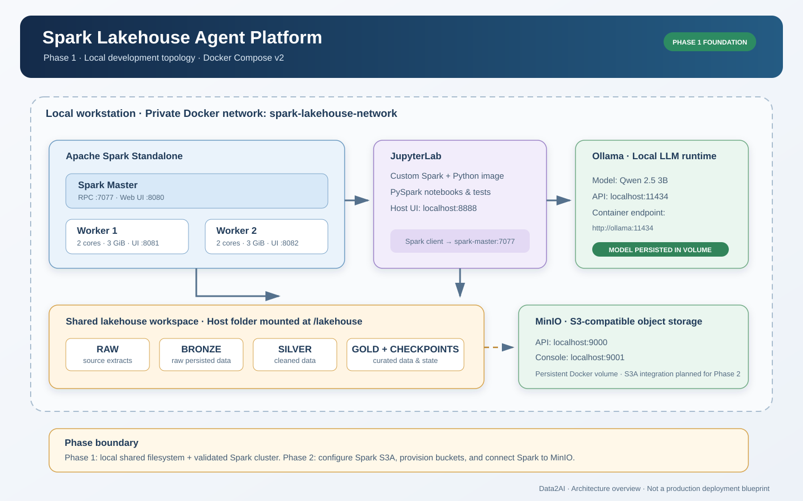
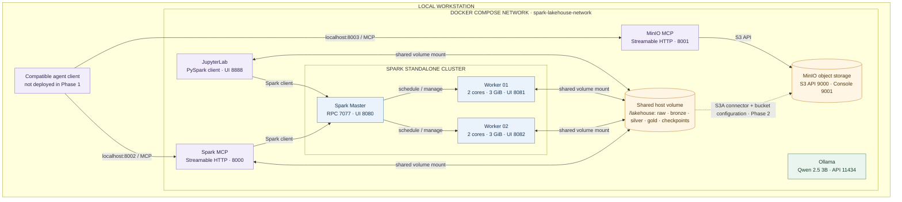
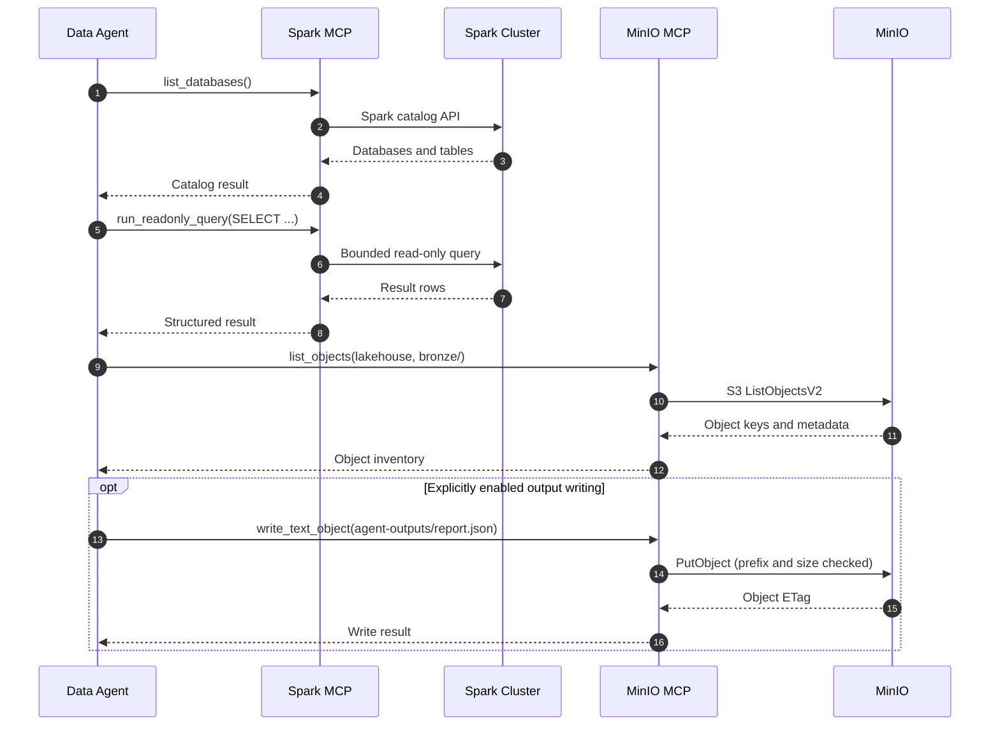

# Spark Lakehouse Agent Platform

A local, Docker Compose-based foundation for a multi-agent retail analytics lakehouse.

**Phase 1 services:** Apache Spark Standalone (1 master + 2 workers), JupyterLab, Ollama, MinIO, Spark MCP and MinIO MCP.

- **Spark:** 3.5.6
- **JupyterLab:** 4.4.5 (custom image)
- **Ollama:** 0.12.6
- **Default local LLM:** `qwen2.5:3b`
- **Storage layout:** shared local Bronze / Silver / Gold directories
- **Deployment:** Docker Compose v2

> **Scope:** Phase 1 deploys and validates the local infrastructure. Retail ingestion, Spark S3A/MinIO integration, CrewAI orchestration, and Streamlit dashboards are planned for later phases. Spark and MinIO MCP servers are included as agent-facing interfaces. MinIO is running and persistent, but Spark-to-MinIO S3A access is not configured in Phase 1.

---

## 1. Architecture

### Visual architecture (SVG)

The static SVG provides a presentation-friendly architecture overview. It is versioned with the source and can be reused in slides and technical documentation.



[Open the SVG source](docs/diagrams/phase-1-architecture.svg)

### Editable deployment architecture (Mermaid)

Use this diagram as the editable logical view. The SVG above is the presentation asset; this Mermaid source is intended for review and maintenance alongside `docker-compose.yml`.



**Connection semantics:** solid arrows represent configured Phase 1 connections or shared mounts. Dashed arrows represent planned integration or application-level usage, not an active Phase 1 data path.

### Lakehouse data lifecycle (Mermaid)

The following is the target processing sequence. Phase 1 creates the directory structure; retail ingestion, transformations, quality checks and data products belong to Phase 2.

```mermaid
flowchart LR
  SOURCE["Retail source<br/>dataset"] --> LANDING["Raw landing<br/>source extract"]
  LANDING --> BRONZE["BRONZE<br/>immutable source-aligned data"]
  BRONZE --> SILVER["SILVER<br/>validated, cleaned, conformed"]
  SILVER --> GOLD["GOLD<br/>business-ready datasets"]
  GOLD --> CONSUMERS["Analytics / BI<br/>Data Agents · Phase 3+"]
  classDef source fill:#eef2f7,stroke:#64748b,color:#1e293b
  classDef bronze fill:#eaf2fb,stroke:#527fa8,color:#17324d
  classDef silver fill:#eaf5ef,stroke:#47845e,color:#183c27
  classDef gold fill:#f2edfa,stroke:#8b78b6,color:#33234e
  classDef future fill:#fff5e5,stroke:#bd8731,color:#4b3512
  class SOURCE,LANDING source
  class BRONZE bronze
  class SILVER silver
  class GOLD gold
  class CONSUMERS future
```


Spark, JupyterLab, Ollama, MinIO and both MCP services communicate over the private Docker network. Published host ports are bound to `127.0.0.1` for local access. The dashed lakehouse-to-MinIO connection is the planned Phase 2 S3A integration, not an active Spark-to-MinIO data path in Phase 1. The compatible agent client shown in the diagram is external to this Compose deployment.

## 2. Prerequisites

| Requirement | Recommendation |
|---|---|
| Docker | Docker Desktop, or Docker Engine |
| Compose | Docker Compose v2 (`docker compose`) |
| RAM | 16 GB minimum recommended; 32 GB preferred |
| Free disk | At least 20 GB recommended when pulling Qwen 2.5 3B |
| CPU | 4 cores or more recommended |
| OS | Linux, macOS, or Windows with Docker Desktop |
| Windows | Hardware virtualization enabled; WSL 2 backend recommended |

The default configuration allocates **2 CPU cores and 3 GiB RAM to each Spark worker**. Ollama model inference also consumes memory. Reduce `SPARK_WORKER_CORES` and `SPARK_WORKER_MEMORY` in `.env` if your workstation has limited resources, and leave memory for Docker and the host OS.

Check your installation:

```bash
docker --version
docker compose version
```

Both commands must succeed. Use a recent Docker Desktop / Docker Engine installation with Compose v2.

## 3. Get the project

Clone the repository and enter its directory:

```bash
git clone https://github.com/msellamiTN/spark-lakehouse-agent.git
cd spark-lakehouse-agent
```

If you already downloaded the source as an archive, extract it and open a terminal in the project root (the directory containing `docker-compose.yml`).

## 4. Configure the environment

Create your local environment file from the template.

### Linux / macOS

```bash
cp .env.example .env
```

### Windows PowerShell

```powershell
Copy-Item .env.example .env
```

Edit `.env` before starting the platform. At minimum, replace these sample values with your own:

```dotenv
JUPYTER_TOKEN=replace-with-a-long-random-secret
MINIO_ROOT_USER=minioadmin
MINIO_ROOT_PASSWORD=replace-with-a-strong-unique-password
```

Do not use the sample credentials for a shared environment. Keep `.env` private: it is excluded by `.gitignore` and must never be committed.

### Main configuration variables

| Variable | Default | Purpose |
|---|---|---|
| `SPARK_IMAGE` | Spark 3.5.6 image | Spark master and worker image |
| `SPARK_WORKER_CORES` | `2` | Cores assigned to each worker |
| `SPARK_WORKER_MEMORY` | `3g` | Memory assigned to each worker |
| `JUPYTER_PORT` | `8888` | JupyterLab host port |
| `JUPYTER_TOKEN` | Must be changed | JupyterLab authentication token |
| `OLLAMA_PORT` | `11434` | Ollama API host port |
| `OLLAMA_MODEL` | `qwen2.5:3b` | Default model name for later integration |
| `MINIO_API_PORT` | `9000` | MinIO S3 API host port |
| `MINIO_CONSOLE_PORT` | `9001` | MinIO web console host port |
| `MINIO_ROOT_USER` | `minioadmin` | MinIO administrator username |
| `MINIO_ROOT_PASSWORD` | Must be changed | MinIO administrator password |

You can change host ports if they conflict with applications already running on your workstation. Keep the `127.0.0.1:` binding in `docker-compose.yml` if the services should remain local-only.

## 5. Deploy on Linux or macOS

Run these commands from the project root:

```bash
chmod +x scripts/*.sh
./scripts/setup.sh
```

The setup script checks Docker and Compose, creates the `.env` file if missing, creates the expected workspace directories, and validates the Compose configuration. If it creates `.env`, edit the credentials before continuing.

Start the services:

```bash
./scripts/up.sh
```

This builds the custom Jupyter image and starts the containers in detached mode. Wait for the health checks to complete, then validate the deployment:

```bash
./scripts/validate.sh
```

## 6. Deploy on Windows (PowerShell)

Open PowerShell in the repository root. Ensure Docker Desktop is running and its Docker Engine is available.

```powershell
Copy-Item .env.example .env
```

Edit `.env`, then run:

```powershell
.\scripts\setup.ps1
.\scripts\up.ps1
.\scripts\validate.ps1
```

If PowerShell blocks script execution, use a process-scoped policy for the current terminal:

```powershell
Set-ExecutionPolicy -Scope Process -ExecutionPolicy Bypass
```

Do not run Linux shell scripts directly in PowerShell. Use the provided `.ps1` scripts, or run the `.sh` scripts from a compatible Bash environment such as WSL after ensuring Docker Desktop integration is enabled for that WSL distribution.

## 7. Download the local language model

The Ollama service starts independently of the model download. Pull the default model after the containers are running.

### Linux / macOS

```bash
./scripts/pull-model.sh
```

Or choose another Ollama model:

```bash
./scripts/pull-model.sh qwen2.5:3b
```

### Windows PowerShell

```powershell
docker compose exec ollama ollama pull qwen2.5:3b
```

Check downloaded models:

```bash
docker compose exec ollama ollama list
```

Model downloads can take time and require additional disk space. The model files are stored in the persistent Docker volume `ollama_models`. The `OLLAMA_MODEL` variable documents the intended model selection for subsequent application/agent integration; pulling a model is a separate operation.

## 8. Open the services

Once the containers are running, open these local endpoints:

| Component | URL | Credentials / notes |
|---|---|---|
| Spark Master UI | [http://localhost:8080](http://localhost:8080) | Cluster overview |
| Spark Worker 1 UI | [http://localhost:8081](http://localhost:8081) | Worker status |
| Spark Worker 2 UI | [http://localhost:8082](http://localhost:8082) | Worker status |
| JupyterLab | [http://localhost:8888](http://localhost:8888) | Token from `.env` |
| Ollama API | [http://localhost:11434](http://localhost:11434) | Local HTTP API |
| MinIO API | [http://localhost:9000](http://localhost:9000) | S3-compatible endpoint |
| MinIO Console | [http://localhost:9001](http://localhost:9001) | User/password from `.env` |

If you changed a host port in `.env`, use that port instead of the default shown above. The services are published on loopback only; they are not exposed for remote access by default.

## 9. Run a Spark smoke test

The repository includes a starter notebook at `notebooks/00_phase1_spark_smoke_test.py`. Open JupyterLab, then open or import that notebook/script from the `notebooks` workspace.

You can also run a minimal distributed PySpark test from the Jupyter container:

```bash
docker compose exec jupyter python3 - <<'PY'
from pyspark.sql import SparkSession

spark = (
    SparkSession.builder
    .appName("lakehouse-smoke-test")
    .master("spark://spark-master:7077")
    .getOrCreate()
)

result = spark.range(0, 1000).count()
print("Rows processed:", result)
print("Spark version:", spark.version)
print("Master:", spark.sparkContext.master)

assert result == 1000
spark.stop()
PY
```

Expected result: `Rows processed: 1000`, with the Spark master shown as `spark://spark-master:7077`.

The validation script performs a similar integration test and also checks service health and MinIO's live endpoint.

## 10. Agent integration through MCP

Phase 1 includes two Model Context Protocol (MCP) servers. They expose Spark and MinIO capabilities to compatible agents through **Streamable HTTP**. The MCP servers are separate services; the project does not prescribe a specific agent framework.

### Service endpoints

| MCP server | Host endpoint | Docker-network endpoint | Purpose |
|---|---|---|---|
| Spark MCP | `http://localhost:8002/mcp` | `http://spark-mcp:8000/mcp` | Spark session, catalog discovery, schema inspection and bounded read-only SQL |
| MinIO MCP | `http://localhost:8003/mcp` | `http://minio-mcp:8001/mcp` | Allowed-bucket discovery, object listing, metadata, bounded text reads and optional text writes |

The host endpoints are bound to `127.0.0.1`. Use the Docker-network endpoints when the agent runtime is another container attached to `spark-lakehouse-network`.

### Deploy or rebuild the MCP services

The MCP services are part of the main Compose project. After configuring `.env`, run:

```bash
docker compose up -d --build spark-mcp minio-mcp
docker compose ps spark-mcp minio-mcp
docker compose logs -f spark-mcp minio-mcp
```

The Spark MCP service waits for the Spark master and both workers to become healthy. The MinIO MCP service starts after the MinIO container has started.

### Spark MCP tools

| Tool | Capability |
|---|---|
| `get_spark_session_info` | Spark version, application ID, master and current database |
| `list_databases` | Discover databases |
| `list_tables` | Discover tables and views in a database |
| `describe_table` | Inspect a table schema |
| `run_readonly_query` | Execute a single bounded `SELECT` query |

The SQL tool rejects non-SELECT statements, semicolons, SQL comments and a set of prohibited commands/functions. Results are capped by `SPARK_MCP_MAX_ROWS` (default 100; hard maximum 500). This is a conservative application-level guardrail, not a substitute for Spark-side identity, authorization and data governance.

### MinIO MCP tools

| Tool | Capability |
|---|---|
| `list_buckets` | List only buckets in the configured allowlist |
| `list_objects` | List up to 500 keys under an allowed prefix |
| `get_object_metadata` | Inspect object metadata without downloading the object |
| `read_text_object` | Read bounded UTF-8 text, JSON, CSV, YAML or Markdown objects |
| `write_text_object` | Write a small text artifact when writes are explicitly enabled |

The default bucket allowlist is `lakehouse`. Create that bucket in the MinIO Console before using the MCP tools, or change `MINIO_MCP_ALLOWED_BUCKETS` to match buckets that already exist.

1. Open [MinIO Console](http://localhost:9001).
2. Sign in using the MinIO credentials in `.env`.
3. Create a bucket named `lakehouse`.
4. For a shared or production-like environment, create a dedicated MinIO service account with access limited to the approved bucket and required prefixes. Set `MINIO_MCP_ACCESS_KEY` and `MINIO_MCP_SECRET_KEY` in `.env`; do not reuse the root account.
5. Restart the MCP service after changing environment values: `docker compose up -d --force-recreate minio-mcp`.

If the dedicated MCP credentials are left blank, the local lab server falls back to the MinIO root credentials. This is for isolated development only; use a least-privilege service account outside a disposable local lab.

### Enable agent writes (optional)

MinIO MCP is **read-only by default**. To enable controlled text writes, set:

```dotenv
MINIO_MCP_ALLOW_WRITES=true
MINIO_MCP_WRITE_PREFIXES=agent-outputs/
MINIO_MCP_ALLOWED_BUCKETS=lakehouse
```

Then recreate the service:

```bash
docker compose up -d --force-recreate minio-mcp
```

The write tool accepts only `text/*` or `application/json`, enforces a 1 MiB default payload limit, and restricts object keys to the configured write prefixes. The MinIO service account must independently have the required write permission. Do not grant broad bucket or administrative permissions merely to make the MCP tool work.

### Connect a compatible agent

For an agent running on the host, the following is a conceptual Streamable HTTP server configuration. Adapt the property names to the MCP client or agent framework you use:

```json
{
  "mcpServers": {
    "spark-lakehouse": {
      "type": "http",
      "url": "http://localhost:8002/mcp"
    },
    "minio-lakehouse": {
      "type": "http",
      "url": "http://localhost:8003/mcp"
    }
  }
}
```

For an agent running inside the same Docker network, replace the URLs with `http://spark-mcp:8000/mcp` and `http://minio-mcp:8001/mcp`. Do not use `localhost` from a separate container to reach these services.

### Agent workflow example



**Important integration boundary:** Spark MCP queries the Spark cluster. MinIO MCP accesses the MinIO S3 API independently. Adding these MCP servers does **not** configure Spark S3A or make MinIO objects automatically queryable as Spark tables. The Spark-to-MinIO S3A connector, bucket provisioning automation and data-lake catalog integration remain Phase 2 work.

### Security boundary

- MCP HTTP endpoints are published only on host loopback by default; no authentication layer is configured in this local development stack.
- Do not expose ports 8002/8003 to a LAN, public network or untrusted agent runtime. Remote deployment requires authenticated transport, TLS, network policy and an identity/authorization design.
- Spark MCP exposes read-only catalog and SELECT operations with bounded results. Do not treat application-level SQL checks as a full security boundary.
- MinIO MCP enforces a bucket allowlist, read/write size limits and write-prefix restrictions. MinIO IAM policies must enforce the same or stricter permissions.
- Keep credentials in `.env`; never commit them or place them in agent prompts.
- For production, use separate least-privilege identities, secret management, audit logging, TLS, and explicit per-agent authorization.

Official references: [MCP Python SDK](https://py.sdk.modelcontextprotocol.io/v1/) · [Streamable HTTP transport](https://py.sdk.modelcontextprotocol.io/v1/).

---

## 11. Lakehouse workspace

The host project contains a shared `lakehouse/` directory mounted into Spark and Jupyter containers:

```text
lakehouse/
├── raw/          # Source extracts (future ingestion phase)
├── bronze/       # Raw persisted datasets
├── silver/       # Cleaned and conformed datasets
├── gold/         # Business-ready data products
└── checkpoints/  # Streaming / processing checkpoints
```

Files written under `/lakehouse` in Jupyter or Spark containers are persisted in the project directory on the host. The `retail/` directory is mounted at `/workspace/retail` and reserved for the retail dataset and ingestion assets.

## 12. Operations and maintenance

Run commands from the project root.

```bash
# List services and health states
docker compose ps

# Follow logs
docker compose logs -f spark-master
docker compose logs -f spark-worker-1 spark-worker-2
docker compose logs -f jupyter
docker compose logs -f ollama
docker compose logs -f minio
docker compose logs -f spark-mcp minio-mcp

# Open a shell in Jupyter
docker compose exec jupyter bash

# List Ollama models
docker compose exec ollama ollama list

# Stop and remove containers/network (keeps named volumes)
docker compose down

# Start again
docker compose up -d
```

To rebuild the custom Jupyter image after changing its Dockerfile:

```bash
docker compose up -d --build
```

### Reset warning

`docker compose down` preserves named volumes, including the Ollama model cache, MinIO data, and Jupyter configuration.

`docker compose down -v` **deletes those named volumes and their persisted data**. Use it only when you intentionally want a full reset. It does not replace a backup.

## 13. Troubleshooting

| Symptom | Checks and remediation |
|---|---|
| Docker command not found | Install/start Docker Desktop or Docker Engine; reopen the terminal and check `docker --version`. |
| Compose command not found | Install a Docker version that includes Compose v2; verify `docker compose version`. |
| Port already allocated | Change the corresponding host port in `.env` (for example `JUPYTER_PORT` or `MINIO_CONSOLE_PORT`) and recreate the stack with `docker compose up -d`. |
| Spark workers do not become healthy | Inspect `docker compose logs spark-master spark-worker-1 spark-worker-2`; check available RAM and worker resource settings. |
| Jupyter is unavailable | Check `docker compose logs jupyter`, wait for its health check, and confirm the token in `.env`. |
| Jupyter authentication fails | Use the exact `JUPYTER_TOKEN` configured in `.env`; recreate the Jupyter container after changing it with `docker compose up -d --force-recreate jupyter`. |
| Image build or pull fails | Check internet access, Docker Hub connectivity, disk space, and Docker daemon status; retry the build. |
| Ollama model pull is slow/fails | Check disk space and network access; retry `docker compose exec ollama ollama pull qwen2.5:3b`. |
| Containers exit unexpectedly | Run `docker compose ps -a` and inspect the relevant service logs. |
| Windows Docker/WSL issue | Start Docker Desktop, confirm the WSL 2 backend and distribution integration, then retry from PowerShell. |

For a focused diagnostic, collect:

```bash
docker compose ps -a
docker compose logs --tail=200
docker system df
```

Review logs before sharing them; remove tokens, passwords, and other sensitive values.

## 14. Security and deployment boundary

- Change the sample Jupyter token and MinIO password before first use.
- Never commit `.env`, credentials, tokens, private datasets, or model secrets.
- Published ports are bound to `127.0.0.1` for local development.
- Do not expose this stack directly to an untrusted network.
- This Compose setup is a development/lab environment, **not a production-hardened deployment**. Production requires a separate security, identity, TLS, secrets, backup, observability, resource, and availability design.
- MinIO is deployed with persistent storage, but Spark S3A dependencies/configuration and bucket provisioning are deferred to Phase 2. Phase 1 persists Parquet and other files on the shared local `/lakehouse` volume.
- CrewAI agents and Streamlit dashboards are not part of the Phase 1 deployment.

## 15. Project roadmap

| Phase | Scope |
|---|---|
| **Phase 1 — Infrastructure** | Docker Compose, Spark cluster, JupyterLab, Ollama, MinIO, validation |
| **Phase 2 — Lakehouse data** | Retail dataset ingestion, Bronze/Silver/Gold transformations, Parquet, data quality, MinIO/S3A integration |
| **Phase 3 — Agent services** | CrewAI orchestration, Supervisor, Data Engineer, Data Analyst, Visualization Engineer |
| **Phase 4 — Analytics application** | Streamlit application, Plotly dashboards, agent-assisted analytics |

## 16. Further documentation

- [Phase 1 technical deployment notes](docs/PHASE-1.md)
- [Spark and MinIO MCP integration guide](docs/mcp/README.md)
- [Architecture diagram standards](docs/diagrams/README.md)
- [Docker Compose configuration](docker-compose.yml)
- [Environment template](.env.example)
- [Spark smoke-test notebook](notebooks/00_phase1_spark_smoke_test.py)

---

**Data2AI — Spark Lakehouse Agent Platform**  
Build the lakehouse foundation first; validate it before adding data pipelines and agents.
