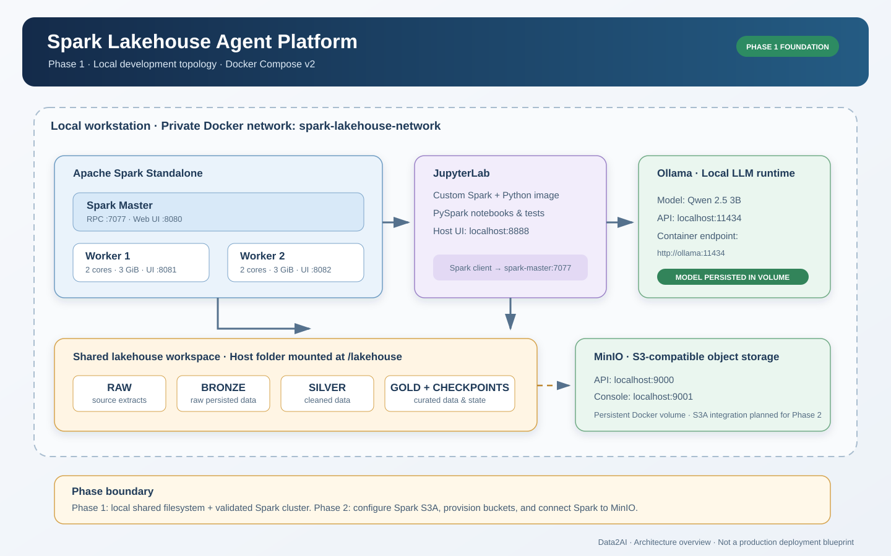
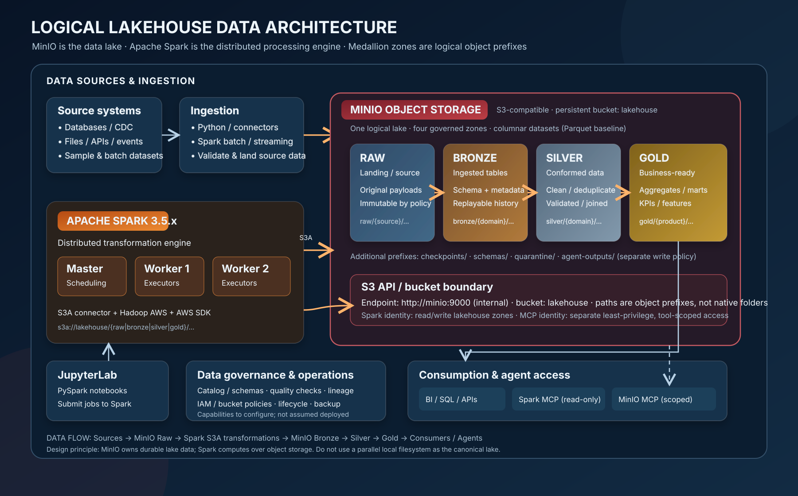

# Spark Lakehouse Agent Platform — Architecture

> **Deployment baseline:** OVH Ubuntu · Docker Compose v2 · Spark Standalone · JupyterLab · Ollama · MinIO · Spark MCP · MinIO MCP · Nginx · Tailscale Serve.  
> **Architectural intent:** private-by-default ingress, explicit trust boundaries, persistent state, scoped agent capabilities, and an honest separation between deployed features and roadmap integrations.

## 1. Executive deployment view

The platform is a single-host training and engineering environment. Compose manages service lifecycle; a private Docker bridge provides east-west connectivity; Tailscale Serve provides tailnet-only HTTPS ingress; Nginx routes requests to separate MCP servers.

### Canonical visual architecture

The following **hand-authored SVG deployment view is the primary architecture artifact**. It is designed for architecture reviews and documentation export; Mermaid diagrams below are supporting editable views for selected flows, not a substitute for the full deployment drawing.



[Open the SVG at full resolution](diagrams/phase-1-architecture.svg)


~~~mermaid
flowchart TB
  subgraph CLIENTS["Learners and agent clients"]
    USER["Engineer / learner"]
    HOST["MCP client / IDE / agent"]
    TSCLIENT["Tailscale client"]
    USER --> HOST --> TSCLIENT
  end
  TSCLIENT -->|"Private HTTPS · TCP 443"| TS
  subgraph OVH["OVH Ubuntu · Docker Compose"]
    subgraph EDGE["Ingress plane · shared network namespace"]
      TS["Tailscale userspace container"]
      SERVE["Tailscale Serve · HTTPS"]
      NGINX["Nginx MCP gateway"]
      TS --> SERVE --> NGINX
    end
    subgraph APP["Application plane · private Docker bridge"]
      SMCP["Spark MCP · read-only SQL"]
      MMCP["MinIO MCP · bucket/prefix scoped"]
      SPARK["Spark master + 2 workers · S3A"]
      JUPYTER["JupyterLab · PySpark"]
      MINIO["MinIO S3 API · lakehouse bucket"]
      OLLAMA["Ollama"]
      NGINX -->|"/spark/mcp"| SMCP
      NGINX -->|"/minio/mcp"| MMCP
      SMCP --> SPARK
      JUPYTER --> SPARK
      SPARK <-->|"S3A · Parquet"| MINIO
      MMCP --> MINIO
    end
    subgraph PERSIST["Persistence plane"]
      SCRATCH[("Local scratch: lakehouse/")]
      MNV[("minio_data · canonical lake")]
      OLV[("ollama_models")]
      JCV[("jupyter_config")]
      TSV[("tailscale_state")]
    end
    JUPYTER --> SCRATCH
    SPARK -. "legacy scratch only" .-> SCRATCH
    MINIO --> MNV
    OLLAMA --> OLV
    JUPYTER --> JCV
    TS --> TSV
  end
~~~

### Network exposure contract

| Endpoint | Exposure | Purpose |
|---|---|---|
| Tailscale Serve TCP 443 | Tailnet only | Remote MCP ingress |
| /spark/mcp | Tailnet only | Spark catalog and bounded read-only SQL |
| /minio/mcp | Tailnet only | Allowlisted MinIO object operations |
| Host ports 8002 / 8003 | 127.0.0.1 only | Local MCP diagnostics |
| Gateway port 8088 | 127.0.0.1 only | Health diagnostics |
| Spark UI, Jupyter, MinIO, Ollama | 127.0.0.1 only | Administrator access |

🔐 **Invariant:** do not bind services to 0.0.0.0 on the host, publish MCP ports publicly, or enable Tailscale Funnel.

## 2. Service architecture and responsibilities

| Plane | Components | Responsibility | Design rule |
|---|---|---|---|
| Access / ingress | Tailscale client, Tailscale container, Serve, Nginx | Private transport and path routing | Only TCP 443 remotely reachable |
| MCP application | Spark MCP, MinIO MCP | Translate tool calls into bounded backend operations | Independent tool and permission surfaces |
| Compute | Spark master, two workers | Distributed Spark execution and S3A I/O to MinIO | Internal Spark RPC; Hadoop/S3A versions aligned |
| Interactive engineering | JupyterLab | Notebook development and Spark client | Token protected; loopback only |
| Object storage | MinIO | Canonical Lakehouse data lake (Raw/Bronze/Silver/Gold) | Persistent volume; Spark S3A; separate service identities |
| Model runtime | Ollama | Local model serving | No assumption of Phase 1 agent integration |
| Persistence | Bind mount and named volumes | Durable data and service state | Never delete volumes for routine troubleshooting |

| Service | Internal endpoint | Persistence |
|---|---|---|
| Spark master | spark-master:7077 | Cluster control; no canonical data stored locally |
| Spark workers | spark-worker-1, spark-worker-2 | Distributed compute; S3A access via worker credentials |
| JupyterLab | jupyter:8888 | jupyter_config; S3A driver; local scratch mount retained |
| Ollama | ollama:11434 | ollama_models |
| MinIO | minio:9000; console :9001 | minio_data — canonical lake objects |
| Spark MCP | spark-mcp:8000/mcp | Stateless |
| MinIO MCP | minio-mcp:8001/mcp | Stateless |
| Nginx gateway | :8080 in shared namespace | Read-only config mount |
| Tailscale | Shared namespace with gateway | tailscale_state |

**Compose topology note:** Tailscale uses network_mode service:mcp-gateway. It shares the gateway network namespace by design. Do not configure a separate container hostname for this sidecar; TS_HOSTNAME sets the Tailscale device name.

## 3. Logical Lakehouse data architecture — MinIO as the data lake

The **logical target architecture** uses MinIO as the canonical and durable Lakehouse storage layer. Raw, Bronze, Silver, and Gold are logical zones represented by object prefixes in the MinIO bucket `lakehouse`; they are not separate storage engines or local directories. Apache Spark performs distributed ingestion and transformation, reading and writing objects through the S3A connector.



[Open the logical Lakehouse SVG at full resolution](diagrams/logical-lakehouse-minio-spark.svg)

### Medallion zones and object layout

```text
s3a://lakehouse/
├── raw/                  # Source-aligned landing; preserve original payloads
├── bronze/               # Ingested, traceable, schema-enriched datasets
├── silver/               # Cleansed, deduplicated, conformed datasets
├── gold/                 # Business-ready aggregates, data products and features
├── checkpoints/          # Structured Streaming checkpoints (separate prefixes)
├── quarantine/           # Invalid or rejected records
└── agent-outputs/        # Optional agent-produced artifacts; separately governed
```

| Zone | Purpose | Typical operations | Recommended controls |
|---|---|---|---|
| Raw | Durable source landing | Capture files/events with source and ingestion metadata | Restrict mutation; retain source provenance |
| Bronze | Replayable, source-aligned tables | Parse, add ingestion timestamps, normalize technical types | Schema tracking; idempotent ingestion |
| Silver | Trusted, reusable domain data | Validate, deduplicate, standardize, join and apply quality rules | Data-quality gates; restricted write ownership |
| Gold | Consumption-oriented products | Aggregate, calculate KPIs, publish curated tables/features | Product-level access; freshness and SLA checks |

**Storage and processing contract**
- MinIO owns durable Lakehouse objects; Spark 3.5.6 is the distributed compute engine.
- The custom Spark image adds `hadoop-aws:3.3.4` and `aws-java-sdk-bundle:1.12.262`, aligned with the Hadoop 3.3.4 client bundled in the base image. The Dockerfile fails if the expected Hadoop client JARs are absent.
- `infrastructure/spark/spark-defaults.conf` configures `s3a://lakehouse/<zone>/<domain>/<dataset>/`, the internal MinIO endpoint, path-style requests and the AWS SDK environment-variable credential provider.
- Spark credentials are injected separately from MinIO root credentials into Jupyter, Spark MCP and both worker containers. Executors therefore receive the same S3A identity as the driver.
- Use Parquet as the baseline columnar format. Plain Parquet is not transactional; Delta Lake or Apache Iceberg require their own compatible runtime/catalog and commit protocol.
- Keep MinIO MCP on its separate, more restricted identity; agent write access remains disabled unless explicitly approved.
- Streaming checkpoints belong in dedicated persistent MinIO prefixes and must not be mixed with curated table data.
- A catalog/metastore, lineage, data-quality framework, retention/lifecycle policies, versioning and backup are governance capabilities to select and configure; they are not implied by MinIO or S3A alone.

### Runtime configuration and acceptance status

The repository now configures the Spark-to-MinIO path in Compose:
- A custom Spark image adds the Hadoop S3A connector and its matching AWS SDK bundle.
- The same `spark-defaults.conf` is mounted into the Spark master/workers, Jupyter and Spark MCP.
- The Jupyter and Spark MCP drivers, plus both Spark workers, receive a dedicated Spark MinIO service-account identity through environment variables.
- Jupyter and Spark MCP wait for MinIO to start before their own startup.

This is **configuration committed to Git**, not proof of a successful OVH runtime. Rebuild the images and run `./scripts/validate.sh`; the added `notebooks/validate_minio_s3a.py` performs a distributed Parquet write/read round trip through S3A and cleans up only its unique validation prefix. Until that test passes on the OVH host, mark live integration as pending.

The `./lakehouse:/lakehouse` bind mount is retained temporarily for legacy notebooks/import scratch space. It is **not** the canonical Lakehouse data store. All durable Raw/Bronze/Silver/Gold datasets and streaming checkpoints belong in MinIO. Service-state volumes (MinIO, Ollama, Jupyter configuration, and Tailscale identity) remain separate from Lakehouse objects.

See the [Spark S3A ↔ MinIO operations guide](storage/MINIO-SPARK-S3A.md) for identity policy, configuration, rebuild and validation steps.

### Local scratch versus canonical data

The bind mount `./lakehouse:/lakehouse` remains for transitional compatibility with existing notebooks and local imports. It must not be used as the authoritative location for Raw/Bronze/Silver/Gold datasets. New Lakehouse code should use `s3a://lakehouse/<zone>/...`. The deployment diagram distinguishes this scratch path from the MinIO data volume.

## 4. MCP capability boundaries

### Spark MCP

Connects to spark://spark-master:7077. It is a catalog and bounded query interface, not a general Spark shell.

| Tools | Capability | Guardrail |
|---|---|---|
| get_spark_session_info | Session/cluster metadata | No caller SQL |
| list_databases, list_tables | Catalog discovery | Identifier validation |
| describe_table | Schema inspection | Identifier validation |
| run_readonly_query | Bounded SELECT | Single statement, row cap, rejects DDL/DML/comments |

### MinIO MCP

Connects to http://minio:9000. list_buckets checks only configured allowlist entries; it is not account-wide bucket enumeration.

| Tool | Capability | Guardrail |
|---|---|---|
| list_buckets | Check configured bucket accessibility | MINIO_MCP_ALLOWED_BUCKETS |
| list_objects | Paginated object listing | Bucket allowlist and bounded page size |
| get_object_metadata | Object metadata | Allowlist and safe object key |
| read_text_object | Bounded UTF-8 text read | Content type/suffix and byte limit |
| write_text_object | Optional text artifact write | Disabled by default; prefix and size/type checks |

**Layered authorization:** Tailscale grants control network reachability; Nginx routes; MCP code validates tool inputs; MinIO IAM/service-account policy enforces object permissions. No layer replaces another.

## 5. Security architecture

1. **Private ingress:** Tailscale Serve is tailnet-only; Funnel is disabled.
2. **No public service listeners:** published Docker ports bind to 127.0.0.1.
3. **Secret handling:** credentials and auth keys stay in local .env, excluded from Git. Never put them in notebooks, prompts, logs, or screenshots.
4. **MinIO identity:** use a dedicated MCP service account, not root. Grant bucket-scoped List/Get and optional Put only under agent-outputs/*.
5. **Spark S3A identity:** use a dedicated Spark service account scoped to the lakehouse bucket; inject it into Spark drivers and workers, never use MinIO root credentials. The current single shared Spark identity is a lab convenience, not per-user or per-domain isolation.
6. **Spark query safety:** preserve read-only validation and bounded result sizes.
7. **Student isolation:** Tailscale ACLs do not isolate Spark sessions, objects, or tool permissions. Per-team identities/buckets and Spark authorization are required before sensitive multi-tenant use.
8. **Persistence safety:** docker compose down -v deletes named volumes, including MinIO data and Tailscale identity.
9. **Operational classification:** single-host training/lab design; not HA or production-hardened multi-tenant architecture.

## 6. Operational lifecycle

~~~mermaid
flowchart TD
  A["Review secrets and .env"] --> B["Compose config validation"]
  B --> C["Start services"]
  C --> D["Check health and logs"]
  D --> E["Check Tailscale status and Serve"]
  E --> F["MCP initialize and tools/list"]
  F --> G["Validate backend permissions"]
  G --> H["Run workload tests"]
  H --> I["Authorize student access"]
~~~

~~~bash
docker compose config --quiet
docker compose ps
docker compose logs --tail=100 tailscale mcp-gateway spark-mcp minio-mcp
docker compose exec tailscale tailscale status
docker compose exec tailscale tailscale serve status
./scripts/validate.sh
~~~

## 7. Architecture decisions

| Decision | Rationale | Consequence |
|---|---|---|
| Single Compose stack | Reproducible lab with minimal host prerequisites | Single-host failure domain |
| Tailscale userspace container | Avoid host Tailscale and privileged TUN dependency | Shared gateway network namespace |
| Nginx path gateway | Stable host and separate MCP paths | Preserve streaming/SSE behaviour |
| Separate MCP servers | Independent capabilities and permissions | Validate both tool contracts |
| Loopback host publishing | Reduce accidental public exposure | Admin access via host or SSH tunnel |
| MinIO named volume | Durable objects across container recreation | Backup/restore is operator responsibility |
| MinIO as canonical Lakehouse | Durable S3-compatible object storage with Spark S3A | Requires bucket-scoped service identity and tested write/read path |

## 8. Change-control checklist

- [ ] Verify changes against docker-compose.yml, Dockerfiles, .env.example, and implementation.
- [ ] Update deployment and data-flow diagrams.
- [ ] Update service inventory, endpoint table, and persistence mapping.
- [ ] Label roadmap integrations explicitly.
- [ ] Re-check loopback bindings, Tailscale Serve paths, and Funnel state.
- [ ] Update [troubleshooting](TROUBLESHOOTING.md).
- [ ] Validate Markdown/Mermaid rendering and relevant deployment tests.
