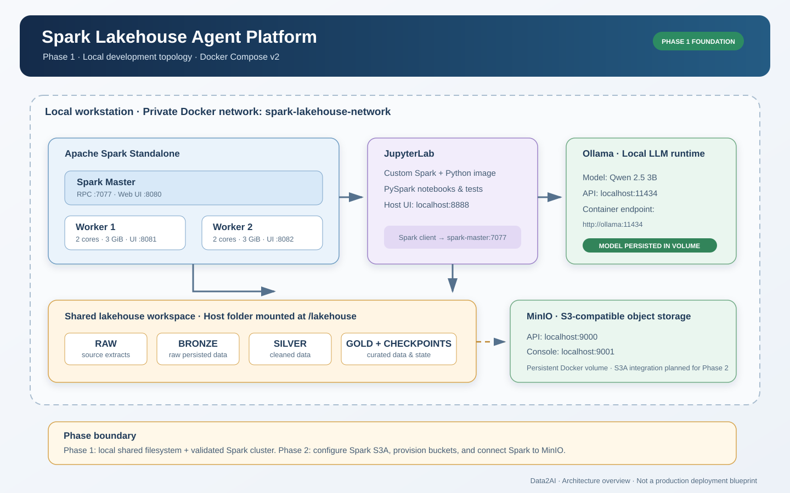
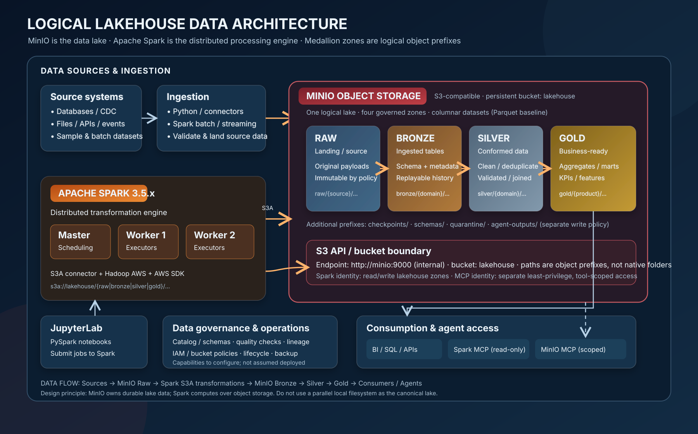

# Architecture diagrams

## Architecture documentation

- [Platform architecture — deployment, data flow, security boundaries and decisions](../ARCHITECTURE.md)
- [Operations troubleshooting and field notes](../TROUBLESHOOTING.md)
- [Default Docker Compose + Tailscale deployment](../mcp/DOCKER-TAILSCALE-STUDENT-LAB.md)

## Primary architecture drawing

The deployment architecture and logical data architecture are maintained as separate hand-authored, high-resolution SVGs. The logical Lakehouse view treats MinIO as the canonical data lake and Spark as the S3A-based processing engine; the deployment view records the currently deployed services and phase boundary.

[Open SVG at full resolution](phase-1-architecture.svg)

## Logical Lakehouse data architecture

[Open logical Lakehouse SVG at full resolution](logical-lakehouse-minio-spark.svg)

The `lakehouse` bucket contains logical `raw/`, `bronze/`, `silver/` and `gold/` prefixes. Compose configures Spark to read and write those zones through S3A. Rebuild the custom image and pass the distributed Parquet validation before marking the integration operational on a host; see [ARCHITECTURE.md](../ARCHITECTURE.md).

## Phase 2.1 — Lakehouse foundation

The editable target data-flow diagram is maintained separately from the Phase 1 deployment SVG. It shows the contract-governed Raw → Bronze → Silver → Gold path, quarantine handling, Spark S3A processing and the optional agent-output boundary.

[Open the Phase 2.1 Mermaid source](phase-2-lakehouse-foundation.mmd) · [Read the Phase 2.1 foundation specification](../PHASE-2.1-LAKEHOUSE-FOUNDATION.md)

The Phase 2.1 diagram is a target data architecture. Contract-driven ingestion is planned for Phase 2.2 and is not represented as a deployed service.

## Diagram catalogue

| Asset | Format | Purpose | Status |
|---|---|---|---|
| [Phase 1 deployment architecture](phase-1-architecture.svg) | SVG | Detailed deployment topology, private ingress, MCP routing, services and persistence | Current deployment view |
| [Logical Lakehouse — MinIO + Spark](logical-lakehouse-minio-spark.svg) | SVG | Raw → Bronze → Silver → Gold object zones, S3A processing and consumers | Logical target architecture |
| [Phase 2.1 Lakehouse foundation](phase-2-lakehouse-foundation.mmd) | Mermaid | Contract-governed Raw → Bronze → Silver → Gold data flow | Target architecture; ingestion deferred to Phase 2.2 |
| Supporting flow views | Mermaid | Selected operational sequences | Supplementary; maintained in [ARCHITECTURE.md](../ARCHITECTURE.md) |

## Source-of-truth rules

1. Runtime configuration is authoritative. Verify services, images, ports, mounts, health checks and environment variables against docker-compose.yml, Dockerfiles and .env.example.
2. Separate deployed capability from roadmap. Dashed connectors represent future or unconfigured integration.
3. Keep deployment and logical views distinct.
4. Do not imply production readiness. These diagrams describe a single-host training/lab environment.
5. Update diagrams and runbooks when services, ports, mounts, dependencies or phase boundaries change.
6. SVG files must include descriptive title and desc elements and remain legible.

## Phase 1 accuracy notes

- Spark MCP is a read-only Streamable HTTP interface to catalog discovery and bounded SELECT queries.
- MinIO MCP is scoped to allowlisted object storage; text writes are disabled by default.
- Spark Standalone has one master and two workers.
- JupyterLab connects to spark://spark-master:7077.
- Spark workers and Jupyter retain the host-mounted /lakehouse directory only for transitional scratch/import compatibility; canonical Raw/Bronze/Silver/Gold objects live in MinIO and are accessed through S3A.
- Ollama is deployed; agent/application integration is not implemented in Phase 1.
- MinIO is persistent and is the canonical Lakehouse storage layer. Compose now configures Spark S3A access; each host must rebuild the custom Spark image and pass the distributed Parquet write/read validation before the integration is marked operational.
- Published service ports bind to loopback; remote MCP access uses Tailscale Serve.

## Storage integration documentation

- [Spark S3A ↔ MinIO runbook](../storage/MINIO-SPARK-S3A.md)

## Change checklist

- [ ] Verify changes against Compose, Dockerfiles and environment configuration.
- [ ] Update architecture and troubleshooting documentation.
- [ ] Re-check phase labels and connector semantics.
- [ ] Verify endpoint and port labels.
- [ ] Review SVG title, description, legibility and GitHub rendering.
