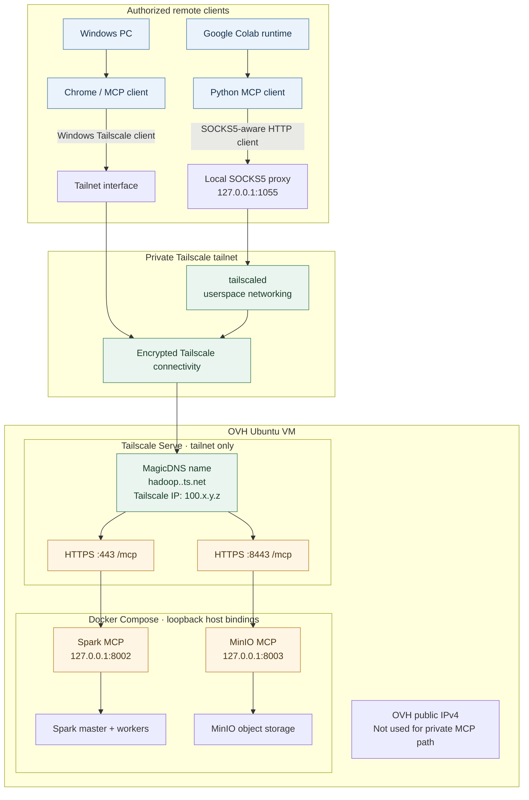

# Remote MCP access from Windows and Google Colab

This guide explains how to reach the Spark MCP and MinIO MCP services running on the OVH Ubuntu VM through a private Tailscale tailnet. It covers Windows/Chrome and Google Colab. It does **not** expose MCP to the public Internet.

> **Deployment model:** OVH public IPv4 is used for normal VM hosting/administration only. MCP traffic travels over Tailscale to the VM's Tailscale address. Do not point the Tailscale-managed `.ts.net` name at the OVH public IPv4.

## 1. Target architecture

The OVH VM runs Docker Compose. Docker publishes the MCP containers only on host loopback. Tailscale Serve terminates tailnet HTTPS and forwards requests to those loopback listeners.



### Connection paths

1. **Windows:** Windows Tailscale client joins the same tailnet. MagicDNS resolves the VM's tailnet hostname to its Tailscale address. Chrome uses HTTPS to Tailscale Serve.
2. **Google Colab:** the runtime starts Tailscale in userspace mode. A local SOCKS5 proxy carries requests from a SOCKS5-aware client into the tailnet. Colab does not need a TUN device or a host-wide VPN route.
3. **OVH VM:** Tailscale Serve forwards HTTPS to the existing loopback-only Docker-published MCP ports. The Docker Compose bindings do not need to change.

## 2. Endpoint map

Use the exact DNS name printed by `sudo tailscale serve status`. The following host is an example; substitute your VM's actual tailnet DNS name if it differs.

| Service | Tailnet HTTPS endpoint | VM loopback backend |
|---|---|---|
| Spark MCP | `https://hadoop.<tailnet>.ts.net/mcp` | `http://127.0.0.1:8002` |
| MinIO MCP | `https://hadoop.<tailnet>.ts.net:8443/mcp` | `http://127.0.0.1:8003` |

The MCP services use Streamable HTTP. A normal browser GET can return HTTP 400/405 because it is not a complete MCP initialize/handshake request. Use an MCP client for protocol validation.

## 3. Prepare the OVH Ubuntu VM

### 3.1 Install and authenticate Tailscale

If Tailscale is already installed and connected, skip installation and verify the status.

```bash
sudo apt-get update
sudo apt-get install -y curl
curl -fsSL https://tailscale.com/install.sh | sh
sudo systemctl enable --now tailscaled
sudo tailscale up
```

Open the authentication URL printed by `tailscale up` and sign in to the tailnet intended for this project.

Verify:

```bash
tailscale version
sudo systemctl status tailscaled --no-pager
tailscale status
tailscale ip -4
```

Record the VM's Tailscale IP and MagicDNS name. The public OVH IP (for example, `217.182.210.159`) is a separate address and is not the private MCP endpoint.

### 3.2 Verify local Docker MCP listeners

Run from the repository root:

```bash
docker compose ps spark-mcp minio-mcp
curl -i http://127.0.0.1:8002/mcp
curl -i http://127.0.0.1:8003/mcp
```

An HTTP response proves that the local listener answered; it does not by itself prove MCP protocol interoperability. Also run the repository validation script:

```bash
sudo ./scripts/validate.sh
```

### 3.3 Enable tailnet HTTPS and MagicDNS

In the Tailscale admin console:

1. Open **DNS**: https://login.tailscale.com/admin/dns
2. Enable **MagicDNS**.
3. Enable **HTTPS Certificates** if the tailnet has not enabled them.
4. Review the certificate-transparency notice: the machine name and tailnet DNS name used for a certificate are publicly recorded in Certificate Transparency logs. Do not use sensitive machine names.
5. Review the tailnet access policy. Only approved users/devices should be allowed to reach the OVH VM on TCP 443 and 8443.

### 3.4 Publish MCP with Tailscale Serve

Keep Docker host bindings on `127.0.0.1`. Configure Serve:

```bash
sudo tailscale serve --bg --https=443 127.0.0.1:8002
sudo tailscale serve --bg --https=8443 127.0.0.1:8003
sudo tailscale serve status
```

Expected shape:

```text
https://hadoop.<tailnet>.ts.net (tailnet only)
|-- / proxy http://127.0.0.1:8002

https://hadoop.<tailnet>.ts.net:8443 (tailnet only)
|-- / proxy http://127.0.0.1:8003
```

Use the exact hostname shown by your own Serve status. Do not assume the example tailnet name.

## 4. Windows and Chrome setup

Install the official client: https://tailscale.com/download/windows

1. Install Tailscale on Windows.
2. Sign in using an account authorized for the same tailnet as the OVH VM.
3. Confirm that both the Windows device and the OVH VM appear in the Tailscale admin console.
4. In the Windows Tailscale client, ensure **Use Tailscale DNS settings** is enabled.
5. In the admin DNS page, confirm MagicDNS is enabled.

Open PowerShell:

```powershell
tailscale status
tailscale ip -4
tailscale ping hadoop
Resolve-DnsName hadoop.<tailnet>.ts.net
Test-NetConnection hadoop.<tailnet>.ts.net -Port 443
Test-NetConnection hadoop.<tailnet>.ts.net -Port 8443
```

Replace `hadoop.<tailnet>.ts.net` with the exact name from `tailscale serve status`.

Then open the endpoints in Chrome:

- `https://hadoop.<tailnet>.ts.net/mcp`
- `https://hadoop.<tailnet>.ts.net:8443/mcp`

A browser may display a protocol error or 405 for a plain GET. This is not a browser UI; the endpoint is an MCP HTTP transport. The key browser-side check is that DNS resolves and the HTTPS certificate/connection is established.

### Windows DNS troubleshooting

If Chrome reports `DNS_PROBE_FINISHED_NXDOMAIN`:

1. Confirm `tailscale status` lists both Windows and the OVH VM.
2. Confirm the Windows Tailscale client is connected to the same tailnet.
3. Confirm MagicDNS is enabled in the admin console.
4. Ensure **Use Tailscale DNS settings** is enabled in the Windows client. If needed, open the tray menu; hold Shift while right-clicking the Tailscale icon to inspect the DNS option.
5. Run `ipconfig /flushdns`, then retry `Resolve-DnsName`.
6. Test the Tailscale IP separately with `Test-NetConnection <VM-TAILSCALE-IP> -Port 443`. If the IP works but the name does not, focus on DNS. If the IP does not work, inspect tailnet connectivity and ACL/grant rules.

Do not create a public DNS A record for the Tailscale-managed `.ts.net` hostname. Do not point it at the OVH public IP.

## 5. Google Colab setup (userspace networking)

Colab is a hosted runtime and is not automatically a member of your tailnet. For a private connection, run a temporary Tailscale node in userspace networking mode. This mode exposes a local SOCKS5 proxy and does not require `/dev/net/tun`.

Official Tailscale guide: https://tailscale.com/docs/concepts/userspace-networking

### 5.1 Create a dedicated ephemeral auth key

In https://login.tailscale.com/admin/settings/keys:

1. Create a short-lived or appropriately expiring **auth key** for Colab.
2. Enable **Ephemeral** so the temporary Colab node is automatically removed after it goes offline.
3. Prefer a pre-approved key only if your tailnet policy requires it.
4. If your tailnet uses device tags, use a dedicated tag such as `tag:colab` and configure the ACL/grant policy to allow that tag to reach only the OVH MCP node on TCP 443 and 8443.
5. Do not create a reusable key unless you have a specific operational need. Never commit or paste the key into notebooks, GitHub, logs, or chat.

An auth key is a credential that can enroll a device into your tailnet. Treat it like a password.

### 5.2 Store the key in Colab Secrets

1. Open the notebook in Google Colab.
2. Open the **Secrets** panel (key icon).
3. Create a secret named `TS_AUTHKEY` containing the auth key.
4. Grant the notebook permission to read this secret.

Do not hard-code the key in a notebook cell.

### 5.3 Start Tailscale userspace networking

Run this cell in Colab. It installs Tailscale, starts an in-memory ephemeral daemon with a local SOCKS5 proxy, and authenticates the runtime using the Colab Secret.

```python
!curl -fsSL https://tailscale.com/install.sh | sh

import os
import subprocess
import time
from google.colab import userdata

auth_key = userdata.get("TS_AUTHKEY")
if not auth_key:
    raise RuntimeError("Create the TS_AUTHKEY secret and grant this notebook access.")

# In-memory state is appropriate for a disposable Colab runtime.
tailscaled = subprocess.Popen(
    [
        "tailscaled",
        "--state=mem:",
        "--tun=userspace-networking",
        "--socks5-server=127.0.0.1:1055",
    ],
    stdout=subprocess.DEVNULL,
    stderr=subprocess.STDOUT,
)

time.sleep(3)

subprocess.run(
    [
        "tailscale", "up",
        f"--auth-key={auth_key}",
        "--hostname=colab-mcp",
    ],
    check=True,
    text=True,
)

subprocess.run(["tailscale", "status"], check=True)
print("Tailscale userspace node is connected.")
```

The userspace daemon does not install a system-wide VPN route. Applications must explicitly use its proxy. Do not assume that setting an environment variable makes every Python networking library proxy-aware.

### 5.4 Test DNS and HTTPS through SOCKS5

Use `curl --socks5-hostname` (not `--socks5`) so the hostname is resolved through the proxy path:

```python
import subprocess

TAILNET_HOST = "hadoop.<tailnet>.ts.net"  # replace with exact Serve hostname

for url in [
    f"https://{TAILNET_HOST}/mcp",
    f"https://{TAILNET_HOST}:8443/mcp",
]:
    result = subprocess.run(
        [
            "curl", "--silent", "--show-error", "--include",
            "--connect-timeout", "10",
            "--max-time", "30",
            "--socks5-hostname", "127.0.0.1:1055",
            url,
        ],
        capture_output=True,
        text=True,
    )
    print(f"URL: {url}")
    print("Exit code:", result.returncode)
    print(result.stdout)
    if result.stderr:
        print("curl stderr:", result.stderr)
```

A 400/405 response to GET may be normal for an MCP Streamable HTTP endpoint. A DNS/proxy/TLS error is not. A complete verification must use an MCP client to send the protocol initialize request and subsequent Streamable HTTP messages.

### 5.5 Configure the Colab MCP client

Use these endpoint URLs in your MCP client:

```python
SPARK_MCP_URL = "https://hadoop.<tailnet>.ts.net/mcp"
MINIO_MCP_URL = "https://hadoop.<tailnet>.ts.net:8443/mcp"
```

The HTTP transport used by the MCP SDK must be configured to use the SOCKS5 proxy at `127.0.0.1:1055`. Proxy configuration is client-library-specific; consult the exact SDK's HTTP transport documentation. Do not assume every MCP SDK honors `ALL_PROXY` automatically.

For command-line tools that honor standard proxy variables, the following may help:

```python
import os
os.environ["ALL_PROXY"] = "socks5://127.0.0.1:1055"
os.environ["all_proxy"] = "socks5://127.0.0.1:1055"
```

For clients that do not support SOCKS5, use a supported HTTP proxy configuration or a client transport that explicitly supports SOCKS5. Do not bypass TLS certificate verification.

### 5.6 Colab lifecycle and cleanup

- Colab runtimes are temporary. When the runtime stops, the ephemeral Tailscale node will eventually be removed from the tailnet.
- Re-run the setup cells for a new runtime. The auth key must still be valid and within its expiry.
- Keep the auth key in Colab Secrets, not in notebook source or outputs.
- Stop the daemon when finished:

```python
tailscaled.terminate()
tailscaled.wait(timeout=10)
```

If the runtime is being discarded, the ephemeral node cleanup also occurs automatically after it goes offline.

## 6. MCP client configuration example

The following is a conceptual Streamable HTTP configuration. The actual schema and proxy options depend on the MCP host/client implementation.

```json
{
  "mcpServers": {
    "spark-lakehouse": {
      "type": "http",
      "url": "https://hadoop.<tailnet>.ts.net/mcp"
    },
    "minio-lakehouse": {
      "type": "http",
      "url": "https://hadoop.<tailnet>.ts.net:8443/mcp"
    }
  }
}
```

The Windows client uses the native Tailscale network interface. Colab must use a SOCKS5-aware HTTP transport configured for `127.0.0.1:1055`.

## 7. Troubleshooting matrix

| Symptom | Likely area | Checks |
|---|---|---|
| Windows Chrome `DNS_PROBE_FINISHED_NXDOMAIN` | Windows DNS / tailnet membership | Tailscale connected, same tailnet, MagicDNS enabled, Use Tailscale DNS enabled |
| DNS resolves but TCP 443 fails | Tailnet routing / ACL / Serve | `tailscale ping`, ACL/grant policy, `tailscale serve status`, VM service state |
| HTTPS certificate error | Tailnet HTTPS setup | Enable HTTPS Certificates; check Serve certificate status and machine name |
| HTTP 400/405 from browser GET | Often expected protocol behavior | Test with an MCP Streamable HTTP client; browser GET is not MCP initialize |
| Colab cannot connect to SOCKS5 | Userspace daemon | Check daemon process and local port 1055; inspect Colab cell errors |
| Colab resolves host outside proxy but not through SOCKS | DNS path | Use `curl --socks5-hostname`, not `--socks5` |
| Colab reaches HTTPS but MCP initialize fails | MCP client transport | Verify SDK Streamable HTTP support and explicit SOCKS5 proxy configuration |
| MCP returns tool errors | MCP application / backend | Inspect `docker compose logs spark-mcp minio-mcp` on OVH |

## 8. Disable remote access

On the OVH VM, remove the two Serve routes:

```bash
sudo tailscale serve --https=443 127.0.0.1:8002 off
sudo tailscale serve --https=8443 127.0.0.1:8003 off
sudo tailscale serve status
```

To remove all Serve configuration on the VM (including any unrelated routes), use `sudo tailscale serve reset` only if that is intended.

## 9. Security requirements

- Keep Compose MCP host bindings on `127.0.0.1`; do not bind MCP ports to `0.0.0.0`.
- Do not configure OVH public firewall rules to expose ports 8002 or 8003.
- Do not point the Tailscale-managed `.ts.net` name to the OVH public IP.
- Do not enable Tailscale Funnel for these data-access services.
- Do not publish JupyterLab, Spark UIs/RPC, MinIO API/console, or Ollama through this MCP Serve configuration.
- Restrict tailnet access to approved users/devices and only the required destination ports.
- Use dedicated least-privilege MinIO MCP credentials. Keep writes disabled unless there is a reviewed use case.
- Tailscale provides private connectivity and encrypted transport; it does not add application-level MCP identity, per-tool authorization, or human approval.
- Treat any device allowed to reach MCP as trusted to invoke the tools exposed by that MCP server.
- Keep host credentials in the untracked `.env` and Colab auth keys in Colab Secrets. Rotate/revoke keys if exposed.

## 10. Official references

- Tailscale userspace networking: https://tailscale.com/docs/concepts/userspace-networking
- Tailscale MagicDNS: https://tailscale.com/docs/features/magicdns
- Tailscale HTTPS certificates: https://tailscale.com/docs/how-to/set-up-https-certificates
- Tailscale Serve: https://tailscale.com/docs/features/tailscale-serve
- Tailscale CLI Serve reference: https://tailscale.com/docs/reference/tailscale-cli/serve
- Tailscale auth keys: https://tailscale.com/kb/1085/auth-keys
- Tailscale ACLs and grants: https://tailscale.com/kb/1018/acls
- MCP Python SDK: https://py.sdk.modelcontextprotocol.io/v1/
