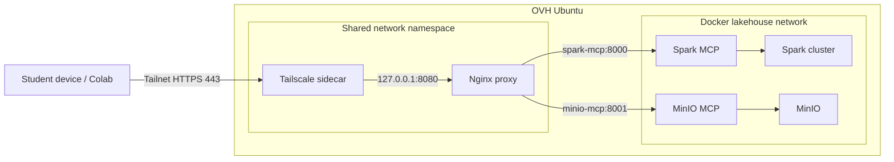

# Dockerized Tailscale access for student projects

**Status: experimental and opt-in.** The existing host-level Tailscale deployment remains the default and is not changed by this profile.

## Goal

Provide a reproducible private-access lab for student engineers without publishing Spark MCP or MinIO MCP ports on the OVH public interface.

The overlay uses:
- the existing Spark MCP and MinIO MCP containers;
- an Nginx reverse proxy attached to the existing `lakehouse` Docker network;
- a Tailscale sidecar sharing Nginx's network namespace;
- Tailscale Serve to provide private HTTPS access to the proxy.

The sidecar and Nginx share a network namespace so Serve can safely proxy to `127.0.0.1:8080`. Nginx resolves the MCP services through Docker DNS.

## Architecture



Use the actual MagicDNS hostname shown by Tailscale:
- Spark MCP: `https://spark-lakehouse-mcp.<tailnet>.ts.net/spark/mcp`
- MinIO MCP: `https://spark-lakehouse-mcp.<tailnet>.ts.net/minio/mcp`

## Administrator prerequisites

1. Enable Tailscale HTTPS certificates.
2. Create and authorize the dedicated tag `tag:spark-lakehouse-mcp`.
3. Create a server auth credential restricted to that tag. Store it only in the untracked `.env` file as `TS_AUTHKEY`. Never commit or share it with students.
4. Ensure `/dev/net/tun` exists on the Docker host.
5. Ensure the existing MCP services are healthy.

## Start the experimental profile

From the repository root, set `TS_AUTHKEY` in the untracked `.env` file, then run:

```bash
docker compose -f docker-compose.yml -f docker-compose.tailscale.yml config
docker compose -f docker-compose.yml -f docker-compose.tailscale.yml up -d --build
docker compose -f docker-compose.yml -f docker-compose.tailscale.yml ps
docker compose -f docker-compose.yml -f docker-compose.tailscale.yml logs --tail=100 tailscale-proxy tailscale-mcp
```

Configure Tailscale Serve inside the sidecar:

```bash
docker compose -f docker-compose.yml -f docker-compose.tailscale.yml exec tailscale-mcp tailscale serve --bg --https=443 127.0.0.1:8080
docker compose -f docker-compose.yml -f docker-compose.tailscale.yml exec tailscale-mcp tailscale serve status
docker compose -f docker-compose.yml -f docker-compose.tailscale.yml exec tailscale-mcp tailscale status
```

Tailscale Serve is tailnet-only. Do not enable Funnel.

## Student access and policy

Each student must authenticate using their own Tailscale user/device identity. Do not distribute the server credential. Grant the student group access only to the service node's TCP 443 endpoint. Do not grant access to SSH, Jupyter, Spark UI/RPC, MinIO API/console, Ollama, or the Docker daemon.

Keep Spark MCP bounded and read-only. Keep MinIO writes disabled unless a lab explicitly requires them.

**Multi-tenant warning:** the current Spark and MinIO MCP backends are shared. Tailscale ACLs control network reachability; they do not implement per-student row-level authorization, bucket isolation, Spark session isolation, or per-tool authorization. For a real class, isolate each project team with a separate Compose project and data/credentials, or implement independent per-team buckets/service accounts and Spark-side authorization before enabling writes or exposing sensitive data. Never give students MinIO root credentials.

## Validate

From an authorized student device, use an MCP client configured with the appropriate URL above. Streamable HTTP POST requests must include:
- `Content-Type: application/json`
- `Accept: application/json, text/event-stream`

A standalone GET to open an SSE stream must include `Accept: text/event-stream`. A GET returning 405 can be normal when the server does not offer a standalone event stream; validate MCP with POST initialize and tools/list.

## Stop and rollback

```bash
docker compose -f docker-compose.yml -f docker-compose.tailscale.yml down
docker volume ls
```

The overlay does not modify the host Tailscale daemon or its Serve configuration. Remove the sidecar state volume only when intentionally de-registering this Docker node; verify its exact name first. This profile uses a separate node hostname, `spark-lakehouse-mcp`.

## Troubleshooting

| Symptom | Checks |
|---|---|
| Sidecar does not authenticate | Check tagged credential, tag authorization, expiry/revocation and sidecar logs. |
| Serve endpoint unavailable | Check `tailscale serve status`, HTTPS certificate settings and tailnet membership. |
| Nginx returns 502 | Check MCP health checks, Docker DNS and `docker compose logs tailscale-proxy`. |
| MCP reports Not Acceptable | POST: accept both JSON and SSE. GET SSE: accept `text/event-stream`. |
| Student reaches unintended services | Review tailnet ACLs and firewall policy; URL paths are not an access-control boundary. |

## References

- [Tailscale Docker](https://tailscale.com/docs/features/containers/docker)
- [Tailscale Docker Compose guide](https://tailscale.com/docs/features/containers/docker/how-to/connect-docker-container)
- [Tailscale Docker parameters](https://tailscale.com/docs/features/containers/docker/docker-params)
- [Tailscale Serve](https://tailscale.com/docs/features/tailscale-serve)
- [MCP Streamable HTTP specification](https://github.com/modelcontextprotocol/modelcontextprotocol/blob/main/docs/specification/2025-03-26/basic/transports.mdx)
