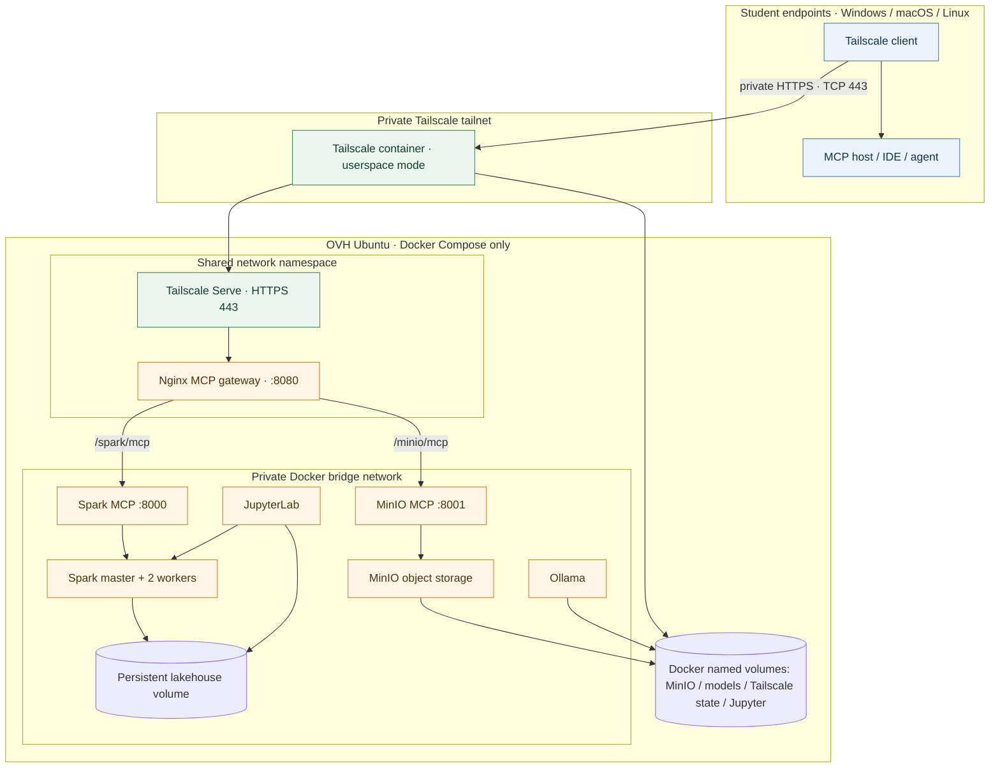

# Default platform deployment: Docker Compose + Tailscale Serve

**This is the default deployment, not an experimental overlay.** The complete platform is deployed with one Compose project. Tailscale runs in a container and Tailscale Serve is configured declaratively at container startup.

## 1. Deployment objective

The OVH Ubuntu host needs Docker Engine and the Docker Compose v2 plugin. It does **not** need a host installation of Tailscale, Nginx, Spark, Java, Python, Jupyter, or MinIO. Those runtime components are containers.

Students can use Windows, macOS, or Linux. Their workstation does not run Spark or the lakehouse stack: it only needs an authorized Tailscale client and an MCP-compatible client. Google Colab uses the supplied userspace/SOCKS5 notebook workflow.

## 2. Default architecture



### Network exposure

| Endpoint | Exposure | Purpose |
|---|---|---|
| Tailscale Serve TCP 443 | Tailnet only | Student MCP access |
| Spark MCP host port 8002 | Host loopback only | Local administrator testing |
| MinIO MCP host port 8003 | Host loopback only | Local administrator testing |
| Gateway host port 8088 | Host loopback only | Local diagnostics |
| Spark UI, Jupyter, MinIO, Ollama | Host loopback only | Administrator access |
| Spark RPC / MinIO API / Docker network | Docker bridge only | Internal service communication |

No MCP port is published on the OVH public interface. Do not enable Tailscale Funnel.

## 3. One-time Tailscale administration

Before deployment, an administrator must:

1. Enable MagicDNS in the Tailscale admin console.
2. Enable HTTPS Certificates for the tailnet.
3. Define/authorize the tag `tag:spark-lakehouse-mcp` in the tailnet policy.
4. Generate a **reusable, non-ephemeral auth key** restricted to that tag for the long-running OVH server container.
5. Configure a grant/ACL so the student group can reach only this node on TCP 443. Do not grant access to SSH, Jupyter, Spark UI/RPC, MinIO API/console, Ollama, or Docker.

The server key enrolls the platform node; it is not a student credential. Students sign in with their own identities. Never share the server key.

## 4. Configure secrets

From the repository root, create the local environment file:

### Linux / macOS
```bash
cp .env.example .env
```

### Windows PowerShell
```powershell
Copy-Item .env.example .env
```

Edit `.env` and set at least:

```dotenv
JUPYTER_TOKEN=<long-random-token>
MINIO_ROOT_PASSWORD=<strong-unique-password>
TS_AUTHKEY=<reusable-tagged-Tailscale-auth-key>
TS_HOSTNAME=spark-lakehouse-agent
```

The `.env` file is ignored by Git. Never commit it, include the key in a notebook, or distribute the server auth key to students. The Compose project persists Tailscale identity in the `tailscale_state` named volume; normal restarts do not require re-authentication.

## 5. Deploy the complete platform

The same commands work on Ubuntu, Windows PowerShell, and macOS once Docker Desktop/Engine and Compose v2 are available.

Validate the fully rendered Compose model:

```bash
docker compose config --quiet
```

Build and start all services, including Tailscale and Serve:

```bash
docker compose up -d --build
docker compose ps
docker compose logs --tail=100 tailscale mcp-gateway
```

Tailscale Serve is configured automatically from `infrastructure/tailscale/serve.json` through `TS_SERVE_CONFIG`. There is no host-level `tailscale serve` command and no separate overlay file.

Inspect the container's Tailscale identity and Serve configuration:

```bash
docker compose exec tailscale tailscale status
docker compose exec tailscale tailscale serve status
```

### Retire the previous host-level Serve routes

The previous deployment may still have Serve routes on the Ubuntu host's original Tailscale node. After the new Docker node is authenticated and both MCP routes have been validated from a student device, inspect the old host routes with `sudo tailscale serve status`. If the old host-level Serve configuration contains only the former MCP routes, remove those old routes with `sudo tailscale serve reset`. Do **not** uninstall or stop the host's `tailscaled` service until you have confirmed that you no longer depend on it for VM administration; the new Docker Tailscale node is a separate identity.

The actual URL is based on the hostname and tailnet DNS name displayed by Tailscale. With the default hostname, the pattern is:

- Spark MCP: `https://spark-lakehouse-agent.<tailnet>.ts.net/spark/mcp`
- MinIO MCP: `https://spark-lakehouse-agent.<tailnet>.ts.net/minio/mcp`

Replace `<tailnet>` with the real tailnet DNS suffix. Do not infer or hard-code it.

## 6. Student access by operating system

### Windows
- Install the official Tailscale client: https://tailscale.com/download/windows
- Sign in with the student's own account, authorized by the tailnet administrator.
- Confirm the device is connected and MagicDNS is enabled.
- Configure the MCP client with the two HTTPS URLs above.

### macOS
- Install the official Tailscale client: https://tailscale.com/download/mac
- Sign in with the student's own account.
- Configure the MCP client with the two HTTPS URLs above.

### Linux
- Install the official Tailscale client for the distribution: https://tailscale.com/download/linux
- Sign in with the student's own account.
- Configure the MCP client with the two HTTPS URLs above.

### Google Colab
Colab does not inherit the student's desktop tailnet connection. Use the repository notebook [01_colab_private_mcp_validation.ipynb](../../notebooks/01_colab_private_mcp_validation.ipynb), which starts an ephemeral userspace Tailscale node and SOCKS5 proxy in the runtime. Store its ephemeral key in Colab Secrets, not in the notebook.

## 7. MCP transport and validation

For Streamable HTTP POST, the client must send:

```http
Content-Type: application/json
Accept: application/json, text/event-stream
```

For a standalone SSE GET, the Accept header must be `text/event-stream`. A browser GET or a 405 response is not an end-to-end MCP test; validate with MCP initialize followed by tools/list.

From the server, validate local backend health:

```bash
./scripts/validate.sh
```

From an authorized student device, validate:
- MagicDNS resolves the container's Tailscale hostname.
- TCP 443 is reachable.
- HTTPS certificate is valid.
- MCP initialize and tools/list succeed for both endpoints.

## 8. Security and isolation boundaries

- Tailscale Serve is private to the tailnet. Funnel is explicitly disabled in the Serve config.
- Only the gateway is reachable through Serve. It exposes only the two exact MCP paths.
- Keep Spark MCP bounded/read-only and MinIO MCP writes disabled by default.
- Tailscale ACLs are network controls, not per-student data authorization. The current Spark/MinIO MCP services are shared. Before onboarding multiple student teams with private datasets or write access, add per-team data separation, MinIO service accounts/buckets, and Spark authorization/session isolation.
- Never expose the MinIO root credentials or Docker socket to students.
- This is a training/lab platform, not a production-hardened multi-tenant service.

## 9. Operations

```bash
# Status and logs
docker compose ps
docker compose logs -f tailscale mcp-gateway spark-mcp minio-mcp

# Stop; named volumes and state are preserved
docker compose down

# Start again; Tailscale identity and Serve configuration are restored
docker compose up -d

# Destructive reset: removes persisted state and data; use only intentionally
docker compose down -v
```

Do not delete `tailscale_state` unless you intend to remove the registered Docker node and authenticate it again.

## 10. Troubleshooting

| Symptom | Check |
|---|---|
| Tailscale container exits | Check `.env`, auth-key validity, tag authorization and `docker compose logs tailscale`. |
| Node authenticates but no Serve URL | Confirm HTTPS certificates and inspect `tailscale serve status`; verify the mounted `serve.json`. |
| Nginx 502 | Check `docker compose ps`, MCP health and `docker compose logs mcp-gateway spark-mcp minio-mcp`. |
| DNS NXDOMAIN on student device | Check same tailnet, MagicDNS, device login and exact DNS name. |
| TCP 443 blocked | Review tailnet grants/ACLs and the student's device status. |
| MCP Not Acceptable | Check the required Streamable HTTP Accept headers; do not use browser GET as protocol validation. |

## Official references

- [Tailscale Docker configuration parameters](https://tailscale.com/docs/features/containers/docker/docker-params)
- [Tailscale Docker Compose](https://tailscale.com/docs/features/containers/docker/how-to/connect-docker-container)
- [Tailscale Serve configuration](https://tailscale.com/docs/features/tailscale-serve)
- [Tailscale Serve CLI](https://tailscale.com/docs/reference/tailscale-cli/serve)
- [Tailscale grants and ACLs](https://tailscale.com/docs/reference/acl)
