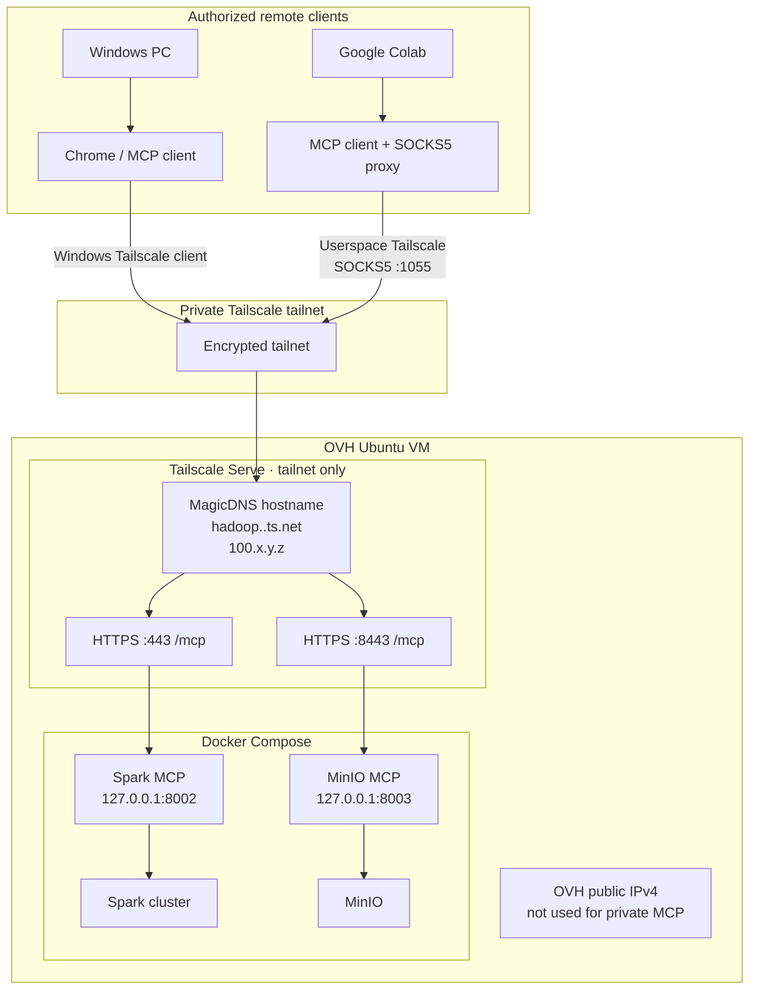

# Secure remote MCP access with Tailscale

This guide configures private HTTPS access to the Spark MCP and MinIO MCP services on the OVH Ubuntu VM from authorized remote devices. It covers the OVH-side configuration and Windows access. For the full Google Colab userspace-networking procedure, see [Remote MCP access from Windows and Google Colab](COLAB-ACCESS.md).

**Security model:** Tailscale provides private connectivity; Tailscale Serve provides HTTPS routing; MCP provides the application protocol. These are separate layers. This guide does not publish MCP to the public Internet.

## 1. Architecture



- **Windows:** install and sign in to the Tailscale client. Chrome uses the VM's MagicDNS hostname over the Windows Tailscale interface.
- **Colab:** it is not automatically in your tailnet. Start Tailscale in userspace mode and configure the Colab MCP HTTP transport to use its local SOCKS5 proxy. Follow [the Colab guide](COLAB-ACCESS.md).
- **OVH:** Tailscale Serve proxies HTTPS requests to Docker-published loopback ports. No Compose binding changes are needed.

## 2. Understand the addresses

The VM has two distinct addresses:

- **OVH public IPv4:** used for ordinary public VM hosting/administration. Do not use it as the private MCP route.
- **Tailscale IP:** a private tailnet address (typically in `100.64.0.0/10`).
- **MagicDNS name:** `<machine>.<tailnet>.ts.net`, resolved for authorized tailnet devices.

Do not attempt to point the Tailscale-managed `.ts.net` hostname to the OVH public IP. MagicDNS manages that name and resolves it to the Tailscale address.

## 3. Install and connect Tailscale on OVH Ubuntu

If not already installed:

```bash
sudo apt-get update
sudo apt-get install -y curl
curl -fsSL https://tailscale.com/install.sh | sh
sudo systemctl enable --now tailscaled
sudo tailscale up
```

Authenticate using the URL printed by `tailscale up`. Then verify:

```bash
tailscale version
sudo systemctl status tailscaled --no-pager
tailscale status
tailscale ip -4
```

Record the machine's exact MagicDNS hostname and Tailscale IP.

## 4. Verify the local MCP backends

From the repository root:

```bash
docker compose ps spark-mcp minio-mcp
curl -i http://127.0.0.1:8002/mcp
curl -i http://127.0.0.1:8003/mcp
sudo ./scripts/validate.sh
```

A plain GET can return an HTTP protocol response such as 400/405; use an MCP client to validate the actual Streamable HTTP initialize flow.

## 5. Enable MagicDNS and HTTPS certificates

Open the [Tailscale DNS admin page](https://login.tailscale.com/admin/dns):

1. Enable MagicDNS.
2. Enable HTTPS Certificates.
3. Review the Certificate Transparency notice: the hostname used for certificates is publicly recorded. Avoid sensitive machine names.
4. Review ACL/grant policy so only approved devices/users can access the VM on TCP 443 and 8443.

## 6. Publish MCP through Tailscale Serve

The Docker Compose bindings must remain loopback-only. Publish the existing host listeners:

```bash
sudo tailscale serve --bg --https=443 127.0.0.1:8002
sudo tailscale serve --bg --https=8443 127.0.0.1:8003
sudo tailscale serve status
```

Use the exact hostname printed by Serve status. Expected mapping:

```text
https://hadoop.<tailnet>.ts.net (tailnet only)
|-- / proxy http://127.0.0.1:8002

https://hadoop.<tailnet>.ts.net:8443 (tailnet only)
|-- / proxy http://127.0.0.1:8003
```

Endpoints:

- Spark MCP: `https://<actual-tailnet-hostname>/mcp`
- MinIO MCP: `https://<actual-tailnet-hostname>:8443/mcp`

## 7. Install Tailscale on Windows and use Chrome

Download: [Tailscale for Windows](https://tailscale.com/download/windows).

1. Install the client.
2. Sign in with an account authorized for the same tailnet as the OVH VM.
3. Confirm both devices appear in the [Tailscale Machines admin page](https://login.tailscale.com/admin/machines).
4. Ensure **Use Tailscale DNS settings** is enabled in the Windows Tailscale client.
5. Confirm MagicDNS is enabled in the DNS admin page.

In PowerShell, replace the example hostname with the exact hostname from `tailscale serve status`:

```powershell
tailscale status
tailscale ip -4
tailscale ping hadoop
Resolve-DnsName hadoop.<tailnet>.ts.net
Test-NetConnection hadoop.<tailnet>.ts.net -Port 443
Test-NetConnection hadoop.<tailnet>.ts.net -Port 8443
```

Open in Chrome:

- `https://hadoop.<tailnet>.ts.net/mcp`
- `https://hadoop.<tailnet>.ts.net:8443/mcp`

A browser GET is not an MCP handshake. An HTTP 400/405 can be normal; use an MCP Streamable HTTP client for end-to-end protocol verification.

### Windows DNS error: DNS_PROBE_FINISHED_NXDOMAIN

1. Verify `tailscale status` shows both Windows and the OVH VM.
2. Verify both devices are connected to the same tailnet.
3. Verify MagicDNS is enabled.
4. Verify Windows is using Tailscale DNS settings.
5. Run `ipconfig /flushdns` and retry `Resolve-DnsName`.
6. Test the VM's Tailscale IP directly: `Test-NetConnection <VM-TAILSCALE-IP> -Port 443`. If the IP works but the name does not, focus on DNS. If the IP fails too, investigate tailnet membership, ACL/grants, and Serve.

Do not create a public A record for the Tailscale-managed hostname or map it to the OVH public IP.

## 8. Google Colab

Colab is a cloud-hosted runtime and does not inherit Windows' Tailscale connection. It needs a separate temporary Tailscale node using userspace networking and an ephemeral auth key stored in Colab Secrets.

Follow the detailed, copyable notebook procedure in [COLAB-ACCESS.md](COLAB-ACCESS.md), including:
- create a dedicated ephemeral auth key and restrict it with a tailnet tag/ACL;
- store the key in Colab Secrets (never in notebook source);
- start `tailscaled --tun=userspace-networking --socks5-server=127.0.0.1:1055`;
- use `curl --socks5-hostname` for DNS and HTTPS smoke tests;
- configure the MCP SDK's HTTP transport explicitly to use SOCKS5;
- validate MCP initialize/Streamable HTTP, not only a browser-style GET.

## 9. Disable remote MCP access

Remove only these Serve routes:

```bash
sudo tailscale serve --https=443 127.0.0.1:8002 off
sudo tailscale serve --https=8443 127.0.0.1:8003 off
sudo tailscale serve status
```

Use `sudo tailscale serve reset` only if you intend to remove every Serve route on this VM.

## 10. Security requirements

- Keep Docker Compose MCP host bindings on `127.0.0.1`; do not change them to `0.0.0.0`.
- Do not open OVH public firewall ports 8002/8003 or forward them from a router.
- Do not enable Tailscale Funnel for these data-access services.
- Do not publish JupyterLab, Spark UIs/RPC, MinIO API/console, or Ollama through these Serve routes.
- Restrict tailnet access to approved users/devices and required destination ports only.
- Use dedicated least-privilege MinIO MCP credentials; writes remain disabled by default.
- Tailscale encryption and tailnet ACLs do not provide application-level MCP identity, per-tool authorization, or human approval.
- Keep OVH credentials in the untracked `.env`; keep Colab auth keys in Colab Secrets. Revoke/rotate any exposed key.

## 11. Official references

- [Tailscale userspace networking](https://tailscale.com/docs/concepts/userspace-networking)
- [Tailscale MagicDNS](https://tailscale.com/docs/features/magicdns)
- [Tailscale HTTPS certificates](https://tailscale.com/docs/how-to/set-up-https-certificates)
- [Tailscale Serve](https://tailscale.com/docs/features/tailscale-serve)
- [Tailscale Serve CLI](https://tailscale.com/docs/reference/tailscale-cli/serve)
- [Tailscale auth keys](https://tailscale.com/kb/1085/auth-keys)
- [Tailscale ACLs and grants](https://tailscale.com/kb/1018/acls)
- [MCP Python SDK](https://py.sdk.modelcontextprotocol.io/v1/)
