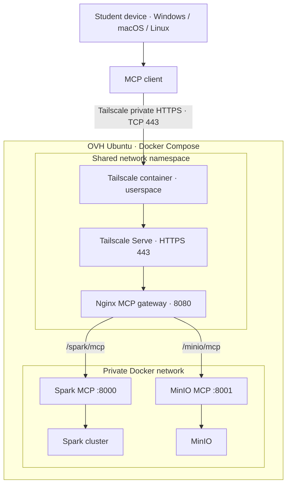

# Private MCP access: Docker Compose + Tailscale Serve

This repository deploys Tailscale as part of the **default Docker Compose stack**. The OVH Ubuntu host does not run a host-level `tailscaled` service and does not require a manual `tailscale serve` setup. The Tailscale container uses userspace networking and loads the checked-in Serve configuration from `infrastructure/tailscale/serve.json`.

For the complete deployment procedure, see [Default platform deployment](DOCKER-TAILSCALE-STUDENT-LAB.md). For Colab, see [COLAB-ACCESS.md](COLAB-ACCESS.md).

## Architecture



## Remote MCP endpoints

Use the actual MagicDNS FQDN shown by:

```bash
docker compose exec tailscale tailscale status
docker compose exec tailscale tailscale serve status
```

Endpoint patterns:

- Spark MCP: `https://spark-lakehouse-agent.<tailnet>.ts.net/spark/mcp`
- MinIO MCP: `https://spark-lakehouse-agent.<tailnet>.ts.net/minio/mcp`

Both routes use HTTPS 443. MCP containers and gateway are not published on the OVH public interface; loopback ports exist only for local administration and diagnostics.

## Server requirements and setup

The host requires Docker Engine and Docker Compose v2 only. It does not require host-level Tailscale, Nginx, Spark, Python, or Java.

Before deployment, the tailnet administrator must enable MagicDNS and HTTPS certificates, authorize `tag:spark-lakehouse-mcp`, create a reusable non-ephemeral auth key restricted to that tag, and allow the student group to reach this node on TCP 443 only.

Store the auth key in the untracked `.env` file as `TS_AUTHKEY`. Never commit it or share it with students.

```bash
cp .env.example .env
# Edit .env: set TS_AUTHKEY, JUPYTER_TOKEN, MINIO_ROOT_PASSWORD
docker compose config --quiet
docker compose up -d --build
docker compose logs --tail=100 tailscale mcp-gateway
docker compose exec tailscale tailscale status
docker compose exec tailscale tailscale serve status
```

Serve is configured automatically with `TS_SERVE_CONFIG`. The configuration explicitly sets `AllowFunnel=false`. Do not enable Funnel.

## Student devices

- Windows: https://tailscale.com/download/windows
- macOS: https://tailscale.com/download/mac
- Linux: https://tailscale.com/download/linux

Each student signs in with their own tailnet identity. Do not distribute the platform's auth key.

Google Colab is not automatically part of the student's tailnet. Use the [Colab access guide and notebook](COLAB-ACCESS.md).

## Security boundaries

- Grant only TCP 443 to the student group.
- Do not expose SSH, Spark UI/RPC, Jupyter, MinIO API/console, Ollama, or Docker daemon.
- Keep MinIO MCP writes disabled unless a reviewed lab requires them.
- Tailnet membership does not implement per-student data isolation or per-tool authorization. Isolate team data and credentials before enabling shared writes or loading private datasets.

## Troubleshooting

| Symptom | Action |
|---|---|
| Tailscale container exits | Inspect `docker compose logs tailscale`; verify auth key, tag and `.env`. |
| Serve route missing | Inspect `tailscale serve status`; check HTTPS certificates and `infrastructure/tailscale/serve.json`. |
| Gateway returns 502 | Check `docker compose ps` and MCP service logs. |
| Student DNS fails | Verify same tailnet, MagicDNS and exact FQDN. |
| TCP 443 blocked | Review tailnet grants/ACLs. |
| MCP Not Acceptable | POST requires `Accept: application/json, text/event-stream`; standalone SSE GET requires `Accept: text/event-stream`. |

## Official references

- [Tailscale Docker parameters](https://tailscale.com/docs/features/containers/docker/docker-params)
- [Tailscale Docker Compose](https://tailscale.com/docs/features/containers/docker/how-to/connect-docker-container)
- [Tailscale Serve](https://tailscale.com/docs/features/tailscale-serve)
- [Tailscale Serve CLI](https://tailscale.com/docs/reference/tailscale-cli/serve)
- [MCP Streamable HTTP](https://github.com/modelcontextprotocol/modelcontextprotocol/blob/main/docs/specification/2025-03-26/basic/transports.mdx)
